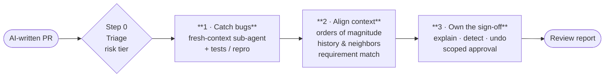

<div align="center">

# Looks Good to AI

<sub>Formerly AI Code Review Triage</sub>

**La IA escribe código más rápido de lo que puedes leerlo. Deja de leer con más esfuerzo y revisa de otra manera.**

Una [Agent Skill](https://agentskills.io) que revisa pull requests escritos por IA dividiendo "leer el código" en tres tareas separadas.<br>
Funciona en Claude Code, Codex, GitHub Copilot, Cursor, Gemini CLI, Antigravity, OpenCode, Windsurf, Cline, Roo Code, Kiro, Amp, Junie y Zed, y se carga como contexto plano en Aider.

<a href="README.md" title="English" aria-label="English">🇬🇧</a> ·
<a href="README.zh-CN.md" title="简体中文" aria-label="简体中文">🇨🇳</a> ·
<a href="README.ja.md" title="日本語" aria-label="日本語">🇯🇵</a> ·
<a href="README.ko.md" title="한국어" aria-label="한국어">🇰🇷</a> ·
<strong title="Español" aria-label="Español">🇪🇸</strong> ·
<a href="README.pt-BR.md" title="Português (Brasil)" aria-label="Português (Brasil)">🇧🇷</a> ·
<a href="README.fr.md" title="Français" aria-label="Français">🇫🇷</a>

<sub>Esto es una traducción; el README en inglés es la fuente de verdad.</sub>

[](https://agentskills.io/specification)
[](#claude-code-plugin)
[](LICENSE)
[](CHANGELOG.md)
[](https://github.com/laulauraluo/looks-good-to-ai/actions/workflows/ci.yml)

<a href="#quick-start">Inicio rápido</a> ·
<a href="#the-idea">La idea</a> ·
<a href="#install">Instalación</a> ·
<a href="#usage">Uso</a> ·
<a href="#examples">Ejemplos</a> ·
<a href="#how-it-works">Cómo funciona</a> ·
<a href="#limits">Límites</a>


</div>

---

## El problema

Los PR escritos por agentes se acumulan más rápido de lo que nadie puede revisarlos línea por línea. Leer con más esfuerzo tampoco ayuda mucho: el código se ve ordenado en la superficie, así que los problemas reales se esconden lo bastante bien como para sobrevivir a una lectura cuidadosa. "Haz merge y, si se rompe, haz rollback" funciona técnicamente, pero una persona sigue respondiendo por el incidente.

<a id="quick-start"></a>
## Inicio rápido

```sh
npx skills add laulauraluo/looks-good-to-ai
```

El CLI de [`skills`](https://github.com/vercel-labs/skills) pregunta qué agentes configurar. Añade `-g` para instalar para tu usuario en lugar de este proyecto, y `-a <agent>` para saltarte la pregunta (`-a claude-code`, `-a codex`, `-a github-copilot`, `-a cursor`, …).

O usa el instalador propio del agente:

| Agente | Comando |
|---|---|
| Claude Code | `/plugin marketplace add laulauraluo/looks-good-to-ai` y luego `/plugin install looks-good-to-ai@looks-good-to-ai` |
| Codex | `codex plugin marketplace add laulauraluo/looks-good-to-ai` y luego `codex plugin add looks-good-to-ai@looks-good-to-ai` |
| GitHub Copilot CLI | `copilot plugin marketplace add laulauraluo/looks-good-to-ai` y luego `copilot plugin install looks-good-to-ai@looks-good-to-ai` |
| Gemini CLI | `gemini extensions install https://github.com/laulauraluo/looks-good-to-ai` |

Después, en tu agente:

```text
Review this AI-generated PR before I merge it.
```

La skill se carga sola con una petición así. La mayoría de los agentes también aceptan `/looks-good-to-ai` para llamarla por su nombre; Codex usa `$looks-good-to-ai`. [docs/agents.md](docs/agents.md) tiene el comando de cada agente.

<a id="the-idea"></a>
## La idea

"Revisar código" siempre ha juntado tres tareas distintas. Eso funcionaba cuando el código llegaba despacio. A la velocidad de los agentes, cada tarea necesita su propio proceso:



| Tarea | Pregunta | Quién la hace mejor |
|---|---|---|
| **Detectar bugs** | ¿El código está mal? | Las máquinas, con una segunda pasada *independiente* |
| **Alinear el contexto** | ¿Es este el cambio correcto para este producto, hoy? | Una persona, revisando ángulos que el diff no puede mostrar |
| **Asumir el sign-off** | ¿Pondré mi nombre en esto? | Quien aprueba, con un alcance explícito |

Los PR de bajo riesgo solo ejecutan el Paso 1. Los de riesgo medio ejecutan los Pasos 1 y 2. Los de alto riesgo (comportamiento en producción, datos, seguridad, dinero) ejecutan los tres.

### Lo que detecta y la revisión línea por línea no

> Un PR cambia `SESSION_TIMEOUT = 30` a `30000` y elimina una línea de conversión de unidades. Los tests pasan. El código está limpio. Quien lee línea por línea lo aprueba en 30 segundos.
>
> - En el **Paso 1**, un sub-agent con contexto limpio añade un test de límites. Resultado: las sesiones ahora caducan a los **30 segundos**.
> - El **Paso 2** revisa el historial y los llamadores. El mismo cambio ya se revirtió una vez, el cliente móvil tiene el valor antiguo fijo en el código, y la petición era solo para usuarios con "recordarme", mientras que el diff cambia a todos.
> - El **Paso 3** bloquea la aprobación. Nadie puede explicar qué hace realmente el PR.
>
> Ejecución completa: [examples/session-timeout-walkthrough.md](examples/session-timeout-walkthrough.md)

<a id="install"></a>
## Instalación

La skill es la carpeta [`skills/looks-good-to-ai/`](skills/looks-good-to-ai). Todos los agentes de abajo la cargan sin cambios; solo cambia la carpeta. [docs/agents.md](docs/agents.md) tiene la tabla completa con cada carpeta que lee cada agente, cómo llama cada agente a una skill y un enlace a la documentación de cada agente.

| Agente | skills CLI | O copia la carpeta en (usuario · proyecto) |
|---|---|---|
| Claude Code | `-a claude-code` | `~/.claude/skills/` · `.claude/skills/` |
| Codex | `-a codex` | `~/.agents/skills/` · `.agents/skills/` |
| GitHub Copilot | `-a github-copilot` | `~/.copilot/skills/` · `.github/skills/` |
| Cursor | `-a cursor` | `~/.cursor/skills/` · `.cursor/skills/` |
| Gemini CLI | `-a gemini-cli` | `~/.gemini/skills/` · `.gemini/skills/` |
| Antigravity | `-a antigravity` | `~/.gemini/config/skills/` · `.agents/skills/` |
| OpenCode | `-a opencode` | `~/.config/opencode/skills/` · `.opencode/skills/` |
| Windsurf | `-a windsurf` | `~/.config/devin/skills/` · `.devin/skills/` |
| Cline | copiar a mano ([por qué](docs/agents.md#cline)) | `~/.cline/skills/` · `.cline/skills/` |
| Roo Code | `-a roo` | `~/.roo/skills/` · `.roo/skills/` |
| Kiro | `-a kiro-cli` | `~/.kiro/skills/` · `.kiro/skills/` |
| Amp | `-a amp` | `~/.config/agents/skills/` · `.agents/skills/` |
| Junie | `-a junie` | `~/.junie/skills/` · `.junie/skills/` |
| Zed | `-a zed` | `~/.agents/skills/` · `.agents/skills/` |
| Aider | — | `read:` en `.aider.conf.yml` ([cómo](docs/agents.md#aider)) |
| Continue | — | Sin verificar; cárgala como regla ([cómo](docs/agents.md#continue)) |

<details>
<summary><b>Con git, sin CLI</b></summary>

<br>

Clona el repositorio una vez y copia la carpeta de la skill en la carpeta del agente que indica la tabla, de modo que `SKILL.md` quede en `<folder>/looks-good-to-ai/SKILL.md`:

```sh
git clone https://github.com/laulauraluo/looks-good-to-ai.git
cp -r looks-good-to-ai/skills/looks-good-to-ai ~/.claude/skills/
```

Cambia `~/.claude/skills/` por cualquier otra carpeta de la tabla. Para una instalación por proyecto, haz commit de la carpeta copiada para que tu equipo también la tenga.

</details>

<details id="claude-code-plugin">
<summary><b>Plugin de Claude Code</b></summary>

<br>

Dentro de Claude Code:

```text
/plugin marketplace add laulauraluo/looks-good-to-ai
/plugin install looks-good-to-ai@looks-good-to-ai
```

</details>

<a id="usage"></a>
## Uso

Pídele a tu agente algo como:

- *"Revisa este PR generado por IA antes de que haga merge."*
- *"¿Se puede hacer merge de este diff? Lo escribió Codex."*
- *"Estoy a punto de aprobar el #123. ¿Qué debería verificar primero?"*
- *"Tenemos demasiados PR de agentes para leerlos línea por línea. Haz triage de este."*

Obtienes un informe como este (del ejemplo inventado del timeout):

```markdown
## Extend session lifetime for "remember me" · Risk: High

### 1. Bugs (independent fresh-context review)
- [CONFIRMED] auth/session.py:3 — unit conversion dropped; sessions expire after 30 s. Repro: test_session_expires_after_timeout

### 2. Context
- Magnitudes: SESSION_TIMEOUT 30 → 30000 (comment says min, code treats as ms) — suspicious
- History / neighbors: reverted once before (a1b2c3d); mobile/src/config.ts hard-codes 30 min
- Requirement match: asked for remember-me users only; diff changes everyone

### 3. Sign-off
- Detection: login-rate and 401-rate alerts · Rollback: config revert
- Recommendation: request changes
- Verification scope: verified units and callers; did not load-test

<sub>Reviewed with [Looks Good to AI](https://github.com/laulauraluo/looks-good-to-ai)</sub>
```

<details>
<summary><b>Más prompts</b>, de las <a href="evals/evals.json">evals</a> de la skill</summary>

<br>

```text
Here's the diff for PR #482. Cursor wrote it to raise our retry count from 3 to 10 on the payments client. Tests pass. Can I approve it?
```

```text
Copilot opened a PR that only fixes typos in docs/ and the README. Do I need the full review process?
```

```text
I wrote this change with you in this session. Now review it before I merge.
```

</details>

<a id="examples"></a>
## Ejemplos

Los dos walkthroughs son escenarios inventados que siguen un PR a lo largo de todos los pasos.

| Walkthrough | Qué falla | Qué lo detecta |
|---|---|---|
| [Session timeout](examples/session-timeout-walkthrough.md) | `30` → `30000` sin la conversión de unidades: las sesiones caducan a los 30 segundos, para todos los usuarios. | Un test de límites en el Paso 1; las unidades, un revert anterior y un valor fijo en el cliente móvil en el Paso 2. |
| [Pagination limit](examples/pagination-limit-walkthrough.md) | Tamaño de página `100` → `1000` contra un proveedor que limita las páginas a 100: la exportación se detiene y faltan 150 de 250 filas. | El contrato del proveedor en el Paso 2, y una reproducción en Python con la biblioteca estándar que puedes ejecutar. |

<a id="how-it-works"></a>
## Cómo funciona

- **[`SKILL.md`](skills/looks-good-to-ai/SKILL.md)** es lo que lee el agente: los niveles de riesgo, los tres pasos, los comandos para historial y llamadores, y la plantilla del informe.
- **El Paso 1 necesita un segundo contexto limpio.** La sesión que escribió el código no puede revisarlo de forma independiente. [`references/subagents.md`](skills/looks-good-to-ai/references/subagents.md) muestra cómo cada agente arranca un revisor nuevo, y qué hacer en los agentes que no tienen ninguno.
- **El Paso 2 necesita una shell con `git`.** Ejecuta `git log -S`, `git log --grep=revert` y `grep` para encontrar historial y llamadores que el diff no muestra.
- **[`evals/evals.json`](evals/evals.json)** contiene prompts de prueba y lo que contiene una buena respuesta. El CI comprueba que el frontmatter de la skill sigue la [Agent Skills spec](https://agentskills.io/specification) y que la reproducción de paginación sigue ejecutándose.

<details>
<summary><b>Estructura del repositorio</b></summary>

<br>

```text
looks-good-to-ai/
├── skills/looks-good-to-ai/   the skill (this folder is what gets installed)
│   ├── SKILL.md                    workflow, risk tiers, report template
│   ├── references/subagents.md     a fresh-context reviewer in each agent
│   └── agents/openai.yaml          display name for the Codex and ChatGPT apps
├── docs/
│   ├── agents.md                   install and use in each agent, with sources
│   └── review-ai-generated-code.md questions and answers
├── examples/                       two invented end-to-end walkthroughs
├── evals/evals.json                test prompts and expected answers
├── scripts/check.py                the checks CI runs
├── .claude-plugin/                 plugin and marketplace manifests (Claude Code, Codex, Copilot CLI)
├── gemini-extension.json           Gemini CLI extension manifest
└── .github/                        CI, issue forms, PR template
```

</details>

<a id="limits"></a>
## Límites

- **Es un proceso de revisión, no un escáner.** Decide qué tiene que ser cierto antes de que apruebes. Ejecuta linters, type checkers y herramientas de seguridad dentro del Paso 1; esta skill no los sustituye.
- **No puede garantizar que un PR sea seguro.** Los ejemplos son casos didácticos inventados, no una tasa de detección medida.
- **Es más lento que una lectura rápida, a propósito.** Un PR de alto riesgo recibe una pasada de sub-agent, tests, búsquedas en el historial y un sign-off por escrito. Los PR de bajo riesgo se saltan la mayor parte.
- **El Paso 1 es tan independiente como el revisor que le des.** En agentes sin sub-agents, abre una sesión nueva a mano.

Preguntas como "¿puede revisar la salida de Codex?" y "¿por qué los tests que pasan pueden no detectar exportaciones incompletas?" se responden en [docs/review-ai-generated-code.md](docs/review-ai-generated-code.md).

## Combina bien con

Esta skill organiza la revisión y decide qué tiene que ser cierto antes de que apruebes. No sustituye a los verificadores especializados. Ejecútalos dentro del Paso 1:

- una revisión centrada en la corrección (por ejemplo el `/code-review` integrado de Claude Code, o el agente de code review de Copilot CLI)
- checklists de seguridad y rendimiento
- revisiones de sobreingeniería

## Contribuir

Los issues y pull requests son bienvenidos. Lee primero [CONTRIBUTING.md](CONTRIBUTING.md): explica cómo enlazar una copia de trabajo a tu agente, los checks que ejecuta el CI y lo que un cambio en `SKILL.md` tiene que conservar.

- [Reportar un problema](https://github.com/laulauraluo/looks-good-to-ai/issues/new?template=bug_report.yml)
- [Añadir o corregir un agente](https://github.com/laulauraluo/looks-good-to-ai/issues/new?template=agent_support.yml)
- [Changelog](CHANGELOG.md)

## Agradecimientos

El enfoque de las tres tareas se inspiró en [una charla pública](https://www.bilibili.com/video/BV1mRn66JERc/) sobre cómo revisar código escrito por IA. La estructura de instalación multiagente sigue a [Anatomy](https://github.com/wheresryan22/anatomy).

## Licencia

[MIT](LICENSE)

---

<div align="center">

Si esto te evitó un mal merge, una ⭐ ayuda a que otros revisores lo encuentren.

</div>
