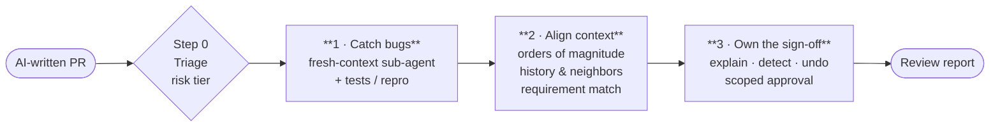

<div align="center">

# Looks Good to AI

<sub>Formerly AI Code Review Triage</sub>

**L'IA écrit du code plus vite que vous ne pouvez le lire. Arrêtez de lire plus fort, relisez autrement.**

Une [Agent Skill](https://agentskills.io) qui relit les pull requests écrites par une IA en découpant « lire le code » en trois tâches distinctes.<br>
Fonctionne dans Claude Code, Codex, GitHub Copilot, Cursor, Gemini CLI, Antigravity, OpenCode, Windsurf, Cline, Roo Code, Kiro, Amp, Junie et Zed, et se charge comme simple contexte dans Aider.

<a href="README.md" title="English" aria-label="English">🇬🇧</a> ·
<a href="README.zh-CN.md" title="简体中文" aria-label="简体中文">🇨🇳</a> ·
<a href="README.ja.md" title="日本語" aria-label="日本語">🇯🇵</a> ·
<a href="README.ko.md" title="한국어" aria-label="한국어">🇰🇷</a> ·
<a href="README.es.md" title="Español" aria-label="Español">🇪🇸</a> ·
<a href="README.pt-BR.md" title="Português (Brasil)" aria-label="Português (Brasil)">🇧🇷</a> ·
<strong title="Français" aria-label="Français">🇫🇷</strong>

*Ceci est une traduction ; le README anglais fait foi.*

[](https://agentskills.io/specification)
[](#claude-code-plugin)
[](LICENSE)
[](CHANGELOG.md)
[](https://github.com/laulauraluo/looks-good-to-ai/actions/workflows/ci.yml)

<a href="#quick-start">Démarrage rapide</a> ·
<a href="#the-idea">L'idée</a> ·
<a href="#install">Installation</a> ·
<a href="#usage">Utilisation</a> ·
<a href="#examples">Exemples</a> ·
<a href="#how-it-works">Fonctionnement</a> ·
<a href="#limits">Limites</a>


</div>

---

## Le problème

Les PR écrites par des agents s'accumulent plus vite que quiconque ne peut les relire ligne par ligne. Lire plus attentivement n'aide pas beaucoup non plus : le code est propre en surface, donc les vrais problèmes se cachent assez bien pour survivre à une lecture soigneuse. « Merger et faire un rollback si ça casse » fonctionne techniquement, mais c'est toujours un humain qui répond de l'incident.

<a id="quick-start"></a>
## Démarrage rapide

```sh
npx skills add laulauraluo/looks-good-to-ai
```

La CLI [`skills`](https://github.com/vercel-labs/skills) demande quels agents configurer. Ajoutez `-g` pour installer pour votre utilisateur plutôt que pour ce projet, et `-a <agent>` pour sauter la question (`-a claude-code`, `-a codex`, `-a github-copilot`, `-a cursor`, …).

Ou utilisez l'installeur propre à l'agent :

| Agent | Commande |
|---|---|
| Claude Code | `/plugin marketplace add laulauraluo/looks-good-to-ai` puis `/plugin install looks-good-to-ai@looks-good-to-ai` |
| Codex | `codex plugin marketplace add laulauraluo/looks-good-to-ai` puis `codex plugin add looks-good-to-ai@looks-good-to-ai` |
| GitHub Copilot CLI | `copilot plugin marketplace add laulauraluo/looks-good-to-ai` puis `copilot plugin install looks-good-to-ai@looks-good-to-ai` |
| Gemini CLI | `gemini extensions install https://github.com/laulauraluo/looks-good-to-ai` |

Ensuite, dans votre agent :

```text
Review this AI-generated PR before I merge it.
```

La skill se charge d'elle-même à partir d'une demande de ce genre. La plupart des agents acceptent aussi `/looks-good-to-ai` pour l'appeler par son nom ; Codex utilise `$looks-good-to-ai`. [docs/agents.md](docs/agents.md) donne la commande pour chaque agent.

<a id="the-idea"></a>
## L'idée

« Relire du code » a toujours regroupé trois tâches différentes. Cela fonctionnait quand le code arrivait lentement. À la vitesse des agents, chaque tâche a besoin de son propre processus :



| Tâche | Question | Qui la fait le mieux |
|---|---|---|
| **Attraper les bugs** | Le code est-il faux ? | Les machines, avec une seconde passe *indépendante* |
| **Aligner le contexte** | Est-ce le bon changement pour ce produit, aujourd'hui ? | Un humain, qui vérifie les angles que le diff ne montre pas |
| **Assumer le sign-off** | Vais-je mettre mon nom là-dessus ? | L'approbateur, avec un périmètre explicite |

Les PR à faible risque ne passent que l'étape 1. Les PR à risque moyen passent les étapes 1 et 2. Les PR à risque élevé (comportement en production, données, sécurité, argent) passent les trois.

### Ce qu'elle repère et que la relecture ligne par ligne rate

> Une PR change `SESSION_TIMEOUT = 30` en `30000` et supprime une ligne de conversion d'unité. Les tests passent. Le code est propre. Un relecteur ligne par ligne l'approuve en 30 secondes.
>
> - **L'étape 1** fait ajouter un test aux limites par un sub-agent au contexte vierge. Résultat : les sessions expirent désormais au bout de **30 secondes**.
> - **L'étape 2** vérifie l'historique et les appelants. Le même changement a déjà été reverté une fois, le client mobile code en dur l'ancienne valeur, et la demande ne concernait que les utilisateurs « remember me » alors que le diff change tout le monde.
> - **L'étape 3** bloque l'approbation. Personne ne peut expliquer ce que fait réellement la PR.
>
> Déroulé complet : [examples/session-timeout-walkthrough.md](examples/session-timeout-walkthrough.md)

<a id="install"></a>
## Installation

La skill est le dossier [`skills/looks-good-to-ai/`](skills/looks-good-to-ai). Chaque agent ci-dessous le charge tel quel ; seul le dossier change. [docs/agents.md](docs/agents.md) contient le tableau complet avec tous les dossiers lus par chaque agent, la façon dont chaque agent appelle une skill, et un lien vers la documentation de chaque agent.

| Agent | skills CLI | Ou copiez le dossier vers (utilisateur · projet) |
|---|---|---|
| Claude Code | `-a claude-code` | `~/.claude/skills/` · `.claude/skills/` |
| Codex | `-a codex` | `~/.agents/skills/` · `.agents/skills/` |
| GitHub Copilot | `-a github-copilot` | `~/.copilot/skills/` · `.github/skills/` |
| Cursor | `-a cursor` | `~/.cursor/skills/` · `.cursor/skills/` |
| Gemini CLI | `-a gemini-cli` | `~/.gemini/skills/` · `.gemini/skills/` |
| Antigravity | `-a antigravity` | `~/.gemini/config/skills/` · `.agents/skills/` |
| OpenCode | `-a opencode` | `~/.config/opencode/skills/` · `.opencode/skills/` |
| Windsurf | `-a windsurf` | `~/.config/devin/skills/` · `.devin/skills/` |
| Cline | copie manuelle ([pourquoi](docs/agents.md#cline)) | `~/.cline/skills/` · `.cline/skills/` |
| Roo Code | `-a roo` | `~/.roo/skills/` · `.roo/skills/` |
| Kiro | `-a kiro-cli` | `~/.kiro/skills/` · `.kiro/skills/` |
| Amp | `-a amp` | `~/.config/agents/skills/` · `.agents/skills/` |
| Junie | `-a junie` | `~/.junie/skills/` · `.junie/skills/` |
| Zed | `-a zed` | `~/.agents/skills/` · `.agents/skills/` |
| Aider | — | `read:` dans `.aider.conf.yml` ([comment](docs/agents.md#aider)) |
| Continue | — | Non vérifié ; à charger comme règle ([comment](docs/agents.md#continue)) |

<details>
<summary><b>Avec git, sans CLI</b></summary>

<br>

Clonez le dépôt une fois et copiez le dossier de la skill dans le dossier de l'agent indiqué dans le tableau, de sorte que `SKILL.md` se retrouve à `<folder>/looks-good-to-ai/SKILL.md` :

```sh
git clone https://github.com/laulauraluo/looks-good-to-ai.git
cp -r looks-good-to-ai/skills/looks-good-to-ai ~/.claude/skills/
```

Remplacez `~/.claude/skills/` par n'importe quel autre dossier du tableau. Pour une installation au niveau projet, faites un commit du dossier copié pour que votre équipe l'ait aussi.

</details>

<details id="claude-code-plugin">
<summary><b>Plugin Claude Code</b></summary>

<br>

Dans Claude Code :

```text
/plugin marketplace add laulauraluo/looks-good-to-ai
/plugin install looks-good-to-ai@looks-good-to-ai
```

</details>

<a id="usage"></a>
## Utilisation

Demandez à votre agent quelque chose comme :

- *« Review this AI-generated PR before I merge it. »*
- *« Can this diff be merged? Codex wrote it. »*
- *« I'm about to approve #123. What should I verify first? »*
- *« We have too many agent PRs to read line by line. Triage this one. »*

Vous obtenez un rapport comme celui-ci (tiré de l'exemple fictif du timeout) :

```markdown
## Extend session lifetime for "remember me" · Risk: High

### 1. Bugs (independent fresh-context review)
- [CONFIRMED] auth/session.py:3 — unit conversion dropped; sessions expire after 30 s. Repro: test_session_expires_after_timeout

### 2. Context
- Magnitudes: SESSION_TIMEOUT 30 → 30000 (comment says min, code treats as ms) — suspicious
- History / neighbors: reverted once before (a1b2c3d); mobile/src/config.ts hard-codes 30 min
- Requirement match: asked for remember-me users only; diff changes everyone

### 3. Sign-off
- Detection: login-rate and 401-rate alerts · Rollback: config revert
- Recommendation: request changes
- Verification scope: verified units and callers; did not load-test

<sub>Reviewed with [Looks Good to AI](https://github.com/laulauraluo/looks-good-to-ai)</sub>
```

<details>
<summary><b>Plus de prompts</b>, tirés des <a href="evals/evals.json">evals</a> de la skill</summary>

<br>

```text
Here's the diff for PR #482. Cursor wrote it to raise our retry count from 3 to 10 on the payments client. Tests pass. Can I approve it?
```

```text
Copilot opened a PR that only fixes typos in docs/ and the README. Do I need the full review process?
```

```text
I wrote this change with you in this session. Now review it before I merge.
```

</details>

<a id="examples"></a>
## Exemples

Les deux déroulés sont des scénarios fictifs qui suivent une PR à travers chaque étape.

| Déroulé | Ce qui tourne mal | Ce qui le détecte |
|---|---|---|
| [Session timeout](examples/session-timeout-walkthrough.md) | `30` → `30000` avec la conversion d'unité supprimée : les sessions expirent au bout de 30 secondes, pour tous les utilisateurs. | Un test aux limites à l'étape 1 ; les unités, un revert passé et une valeur mobile codée en dur à l'étape 2. |
| [Pagination limit](examples/pagination-limit-walkthrough.md) | Taille de page `100` → `1000` face à un fournisseur qui plafonne les pages à 100 : l'export s'arrête avec 150 lignes manquantes sur 250. | Le contrat du fournisseur à l'étape 2, et une reproduction Python en bibliothèque standard que vous pouvez exécuter. |

<a id="how-it-works"></a>
## Fonctionnement

- **[`SKILL.md`](skills/looks-good-to-ai/SKILL.md)** est ce que l'agent lit : les niveaux de risque, les trois étapes, les commandes pour l'historique et les appelants, et le modèle de rapport.
- **L'étape 1 nécessite un second contexte, vierge.** La session qui a écrit le code ne peut pas le relire de façon indépendante. [`references/subagents.md`](skills/looks-good-to-ai/references/subagents.md) montre comment chaque agent lance un relecteur neuf, et quoi faire dans les agents qui n'en ont pas.
- **L'étape 2 nécessite un shell avec `git`.** Elle exécute `git log -S`, `git log --grep=revert` et `grep` pour trouver l'historique et les appelants que le diff ne montre pas.
- **[`evals/evals.json`](evals/evals.json)** contient des prompts de test et ce qu'une bonne réponse doit contenir. La CI vérifie que le frontmatter de la skill respecte la [spécification Agent Skills](https://agentskills.io/specification) et que la reproduction de pagination tourne toujours.

<details>
<summary><b>Structure du dépôt</b></summary>

<br>

```text
looks-good-to-ai/
├── skills/looks-good-to-ai/   the skill (this folder is what gets installed)
│   ├── SKILL.md                    workflow, risk tiers, report template
│   ├── references/subagents.md     a fresh-context reviewer in each agent
│   └── agents/openai.yaml          display name for the Codex and ChatGPT apps
├── docs/
│   ├── agents.md                   install and use in each agent, with sources
│   └── review-ai-generated-code.md questions and answers
├── examples/                       two invented end-to-end walkthroughs
├── evals/evals.json                test prompts and expected answers
├── scripts/check.py                the checks CI runs
├── .claude-plugin/                 plugin and marketplace manifests (Claude Code, Codex, Copilot CLI)
├── gemini-extension.json           Gemini CLI extension manifest
└── .github/                        CI, issue forms, PR template
```

</details>

<a id="limits"></a>
## Limites

- **C'est un processus de revue, pas un scanner.** Il décide de ce qui doit être vrai avant que vous approuviez. Lancez linters, type checkers et outils de sécurité dans l'étape 1 ; cette skill ne les remplace pas.
- **Elle ne peut pas garantir qu'une PR est sûre.** Les exemples sont des cas pédagogiques fictifs, pas un taux de détection mesuré.
- **Elle est plus lente qu'un survol, volontairement.** Une PR à risque élevé a droit à une passe de sub-agent, des tests, des recherches dans l'historique et un sign-off écrit. Les PR à faible risque en sautent l'essentiel.
- **L'étape 1 n'est indépendante qu'à la hauteur du relecteur que vous lui donnez.** Dans les agents sans sub-agents, ouvrez une nouvelle session à la main.

Des questions comme « peut-elle relire du code produit par Codex ? » et « pourquoi des tests qui passent peuvent-ils rater des exports incomplets ? » trouvent leur réponse dans [docs/review-ai-generated-code.md](docs/review-ai-generated-code.md).

## Fonctionne bien avec

Cette skill organise la revue et décide de ce qui doit être vrai avant que vous approuviez. Elle ne remplace pas les outils de vérification spécialisés. Lancez-les dans l'étape 1 :

- une revue centrée sur la correction (par exemple `/code-review`, intégré à Claude Code, ou l'agent code-review de Copilot CLI)
- des checklists de sécurité et de performance
- des revues de sur-ingénierie

## Contribuer

Les issues et pull requests sont les bienvenues. Lisez d'abord [CONTRIBUTING.md](CONTRIBUTING.md) : il explique comment lier une copie de travail à votre agent, les vérifications que lance la CI, et ce qu'un changement de `SKILL.md` doit préserver.

- [Signaler un problème](https://github.com/laulauraluo/looks-good-to-ai/issues/new?template=bug_report.yml)
- [Ajouter ou corriger un agent](https://github.com/laulauraluo/looks-good-to-ai/issues/new?template=agent_support.yml)
- [Changelog](CHANGELOG.md)

## Remerciements

Le découpage en trois tâches s'inspire d'[une conférence publique](https://www.bilibili.com/video/BV1mRn66JERc/) sur la relecture de code écrit par une IA. L'organisation de l'installation multi-agents suit [Anatomy](https://github.com/wheresryan22/anatomy).

## Licence

[MIT](LICENSE)

---

<div align="center">

Si cela vous a évité un mauvais merge, une ⭐ aide d'autres relecteurs à le trouver.

</div>
