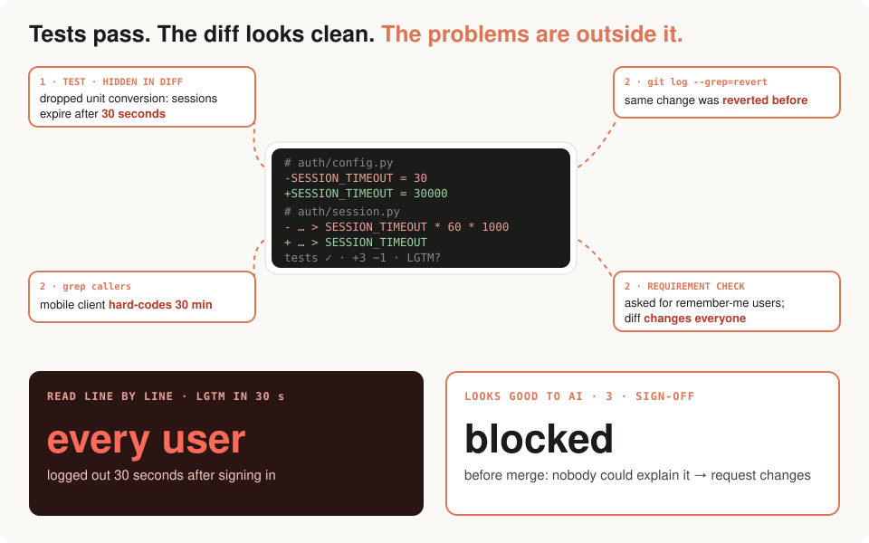
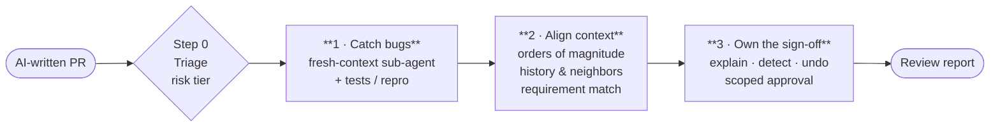

<div align="center">

# Looks Good to AI

<sub>Formerly AI Code Review Triage</sub>

**AI がコードを書く速さは、あなたが読む速さを上回っています。もっと頑張って読むのはやめて、レビューのやり方を変えましょう。**

AI が書いた pull request を、「コードを読む」という作業を 3 つの別々の仕事に分けてレビューする [Agent Skill](https://agentskills.io) です。<br>
Claude Code、Codex、GitHub Copilot、Cursor、Gemini CLI、Antigravity、OpenCode、Windsurf、Cline、Roo Code、Kiro、Amp、Junie、Zed で動作し、Aider ではプレーンなコンテキストとして読み込めます。

<a href="README.md" title="English" aria-label="English">🇬🇧</a> ·
<a href="README.zh-CN.md" title="简体中文" aria-label="简体中文">🇨🇳</a> ·
<strong title="日本語" aria-label="日本語">🇯🇵</strong> ·
<a href="README.ko.md" title="한국어" aria-label="한국어">🇰🇷</a> ·
<a href="README.es.md" title="Español" aria-label="Español">🇪🇸</a> ·
<a href="README.pt-BR.md" title="Português (Brasil)" aria-label="Português (Brasil)">🇧🇷</a> ·
<a href="README.fr.md" title="Français" aria-label="Français">🇫🇷</a>

これは翻訳版です。正本は英語の README です。

[](https://agentskills.io/specification)
[](#claude-code-plugin)
[](LICENSE)
[](CHANGELOG.md)
[](https://github.com/laulauraluo/looks-good-to-ai/actions/workflows/ci.yml)

<a href="#quick-start">クイックスタート</a> ·
<a href="#the-idea">考え方</a> ·
<a href="#install">インストール</a> ·
<a href="#usage">使い方</a> ·
<a href="#examples">例</a> ·
<a href="#how-it-works">仕組み</a> ·
<a href="#limits">制限</a>



</div>

---

<a id="the-problem"></a>
## 課題

エージェントが書いた PR は、誰かが一行ずつレビューできる速さを超えて溜まっていきます。もっと注意深く読んでもあまり効果はありません。表面上はきれいなコードなので、本当の問題は丁寧に読んでもすり抜けるほどうまく隠れています。「とりあえず merge して、壊れたら戻せばいい」は技術的には成り立ちますが、障害の責任を負うのは結局人間です。

<a id="quick-start"></a>
## クイックスタート

```sh
npx skills add laulauraluo/looks-good-to-ai
```

[`skills`](https://github.com/vercel-labs/skills) CLI が、どのエージェントにセットアップするかを尋ねます。このプロジェクトではなくユーザー単位でインストールするには `-g` を、質問を省略するには `-a <agent>` を付けます（`-a claude-code`、`-a codex`、`-a github-copilot`、`-a cursor`、…）。

または、エージェント自身のインストーラーを使います。

| エージェント | コマンド |
|---|---|
| Claude Code | `/plugin marketplace add laulauraluo/looks-good-to-ai` の後に `/plugin install looks-good-to-ai@looks-good-to-ai` |
| Codex | `codex plugin marketplace add laulauraluo/looks-good-to-ai` の後に `codex plugin add looks-good-to-ai@looks-good-to-ai` |
| GitHub Copilot CLI | `copilot plugin marketplace add laulauraluo/looks-good-to-ai` の後に `copilot plugin install looks-good-to-ai@looks-good-to-ai` |
| Gemini CLI | `gemini extensions install https://github.com/laulauraluo/looks-good-to-ai` |

あとはエージェントでこう頼みます。

```text
Review this AI-generated PR before I merge it.
```

このような依頼があれば skill は自動で読み込まれます。多くのエージェントでは `/looks-good-to-ai` で名前を指定して呼び出すこともでき、Codex では `$looks-good-to-ai` を使います。各エージェントのコマンドは [docs/agents.md](docs/agents.md) にあります。

<a id="the-idea"></a>
## 考え方

「コードレビュー」には昔から 3 つの異なる仕事がまとめて詰め込まれていました。コードがゆっくり届いていた頃はそれで回っていました。エージェントの速度では、それぞれの仕事に専用のプロセスが必要です。



| 仕事 | 問い | 最も得意なのは |
|---|---|---|
| **バグを見つける** | コードは間違っていないか？ | 機械。ただし*独立した*二度目のチェックで |
| **コンテキストを合わせる** | 今日のこのプロダクトにとって正しい変更か？ | 人間。diff には現れない観点を確認する |
| **sign-off に責任を持つ** | 自分の名前をこれに載せられるか？ | 承認者。範囲を明示して |

低リスクの PR は Step 1 だけを実行します。中リスクの PR は Step 1 と 2 を実行します。高リスクの PR（本番の挙動、データ、セキュリティ、お金）は 3 つすべてを実行します。

<a id="what-it-catches-that-line-by-line-review-misses"></a>
### 行単位のレビューでは見逃すもの

> ある PR が `SESSION_TIMEOUT = 30` を `30000` に変更し、単位変換の行を 1 行削除します。テストは通ります。コードはきれいです。一行ずつ読むレビュアーは 30 秒で承認します。
>
> - **Step 1** では、fresh-context の sub-agent が境界値テストを追加します。結果：セッションが **30 秒**で切れるようになっていました。
> - **Step 2** では履歴と呼び出し元を確認します。同じ変更は以前一度 revert されており、モバイルクライアントは古い値をハードコードしていて、依頼は「ログイン状態を保持する」ユーザーだけが対象だったのに、diff は全員を変更しています。
> - **Step 3** は承認をブロックします。この PR が実際に何をするのか、誰も説明できないからです。
>
> 全体の流れ：[examples/session-timeout-walkthrough.md](examples/session-timeout-walkthrough.md)

<a id="install"></a>
## インストール

skill の本体はフォルダ [`skills/looks-good-to-ai/`](skills/looks-good-to-ai) です。下のどのエージェントもこれをそのまま読み込み、違うのはフォルダの場所だけです。各エージェントが読むすべてのフォルダ、skill の呼び出し方、各エージェントの公式ドキュメントへのリンクをまとめた完全な表は [docs/agents.md](docs/agents.md) にあります。

| エージェント | skills CLI | またはフォルダのコピー先（ユーザー · プロジェクト） |
|---|---|---|
| Claude Code | `-a claude-code` | `~/.claude/skills/` · `.claude/skills/` |
| Codex | `-a codex` | `~/.agents/skills/` · `.agents/skills/` |
| GitHub Copilot | `-a github-copilot` | `~/.copilot/skills/` · `.github/skills/` |
| Cursor | `-a cursor` | `~/.cursor/skills/` · `.cursor/skills/` |
| Gemini CLI | `-a gemini-cli` | `~/.gemini/skills/` · `.gemini/skills/` |
| Antigravity | `-a antigravity` | `~/.gemini/config/skills/` · `.agents/skills/` |
| OpenCode | `-a opencode` | `~/.config/opencode/skills/` · `.opencode/skills/` |
| Windsurf | `-a windsurf` | `~/.config/devin/skills/` · `.devin/skills/` |
| Cline | 手動でコピー（[理由](docs/agents.md#cline)） | `~/.cline/skills/` · `.cline/skills/` |
| Roo Code | `-a roo` | `~/.roo/skills/` · `.roo/skills/` |
| Kiro | `-a kiro-cli` | `~/.kiro/skills/` · `.kiro/skills/` |
| Amp | `-a amp` | `~/.config/agents/skills/` · `.agents/skills/` |
| Junie | `-a junie` | `~/.junie/skills/` · `.junie/skills/` |
| Zed | `-a zed` | `~/.agents/skills/` · `.agents/skills/` |
| Aider | — | `.aider.conf.yml` の `read:`（[方法](docs/agents.md#aider)） |
| Continue | — | 未検証。rule として読み込む（[方法](docs/agents.md#continue)） |

<details>
<summary><b>CLI を使わず git で</b></summary>

<br>

リポジトリを一度 clone し、skill フォルダを表にあるエージェントのフォルダへコピーして、`SKILL.md` が `<folder>/looks-good-to-ai/SKILL.md` に置かれるようにします。

```sh
git clone https://github.com/laulauraluo/looks-good-to-ai.git
cp -r looks-good-to-ai/skills/looks-good-to-ai ~/.claude/skills/
```

`~/.claude/skills/` は表にある他のフォルダに置き換えてかまいません。プロジェクト単位でインストールする場合は、コピーしたフォルダを commit すればチームにも行き渡ります。

</details>

<details id="claude-code-plugin">
<summary><b>Claude Code plugin</b></summary>

<br>

Claude Code の中で：

```text
/plugin marketplace add laulauraluo/looks-good-to-ai
/plugin install looks-good-to-ai@looks-good-to-ai
```

</details>

<a id="usage"></a>
## 使い方

エージェントに次のように頼みます。

- *「merge する前に、この AI 製の PR をレビューして。」*
- *「この diff は merge していい？Codex が書いたもの。」*
- *「これから #123 を承認する。先に何を確認すべき？」*
- *「エージェントの PR が多すぎて一行ずつ読めない。これをトリアージして。」*

次のようなレポートが返ってきます（架空の timeout の例より）。

```markdown
## Extend session lifetime for "remember me" · Risk: High

### 1. Bugs (independent fresh-context review)
- [CONFIRMED] auth/session.py:3 — unit conversion dropped; sessions expire after 30 s. Repro: test_session_expires_after_timeout

### 2. Context
- Magnitudes: SESSION_TIMEOUT 30 → 30000 (comment says min, code treats as ms) — suspicious
- History / neighbors: reverted once before (a1b2c3d); mobile/src/config.ts hard-codes 30 min
- Requirement match: asked for remember-me users only; diff changes everyone

### 3. Sign-off
- Detection: login-rate and 401-rate alerts · Rollback: config revert
- Recommendation: request changes
- Verification scope: verified units and callers; did not load-test

<sub>Reviewed with [Looks Good to AI](https://github.com/laulauraluo/looks-good-to-ai)</sub>
```

<details>
<summary><b>その他のプロンプト</b>（skill の <a href="evals/evals.json">evals</a> より）</summary>

<br>

```text
Here's the diff for PR #482. Cursor wrote it to raise our retry count from 3 to 10 on the payments client. Tests pass. Can I approve it?
```

```text
Copilot opened a PR that only fixes typos in docs/ and the README. Do I need the full review process?
```

```text
I wrote this change with you in this session. Now review it before I merge.
```

</details>

<a id="examples"></a>
## 例

どちらの walkthrough も、1 つの PR をすべてのステップで追いかける架空のシナリオです。

| Walkthrough | 何がおかしいか | 何が見つけるか |
|---|---|---|
| [Session timeout](examples/session-timeout-walkthrough.md) | `30` → `30000` で単位変換が抜け落ち、全ユーザーのセッションが 30 秒で切れる。 | Step 1 の境界値テスト。Step 2 の単位、過去の revert、モバイル側のハードコード値。 |
| [Pagination limit](examples/pagination-limit-walkthrough.md) | ページサイズ `100` → `1000`。しかしプロバイダーはページを 100 件までに制限しており、export は 250 行中 150 行が欠けたまま止まる。 | Step 2 のプロバイダー契約と、実行できる標準ライブラリだけの Python 再現コード。 |

<a id="how-it-works"></a>
## 仕組み

- **[`SKILL.md`](skills/looks-good-to-ai/SKILL.md)** はエージェントが読むファイルです。リスク階層、3 つのステップ、履歴と呼び出し元を調べるコマンド、レポートのテンプレートが入っています。
- **Step 1 には、別のクリーンなコンテキストが必要です。** コードを書いたセッション自身は独立してレビューできません。[`references/subagents.md`](skills/looks-good-to-ai/references/subagents.md) に、各エージェントで新しいレビュアーを起動する方法と、その仕組みがないエージェントでの対処法をまとめています。
- **Step 2 には `git` が使えるシェルが必要です。** `git log -S`、`git log --grep=revert`、`grep` を実行して、diff に現れない履歴と呼び出し元を探します。
- **[`evals/evals.json`](evals/evals.json)** にはテスト用プロンプトと、良い回答に含まれるべき内容が入っています。CI は skill の frontmatter が [Agent Skills spec](https://agentskills.io/specification) に従っていること、そして pagination の再現コードがまだ動くことをチェックします。

<details>
<summary><b>リポジトリ構成</b></summary>

<br>

```text
looks-good-to-ai/
├── skills/looks-good-to-ai/   the skill (this folder is what gets installed)
│   ├── SKILL.md                    workflow, risk tiers, report template
│   ├── references/subagents.md     a fresh-context reviewer in each agent
│   └── agents/openai.yaml          display name for the Codex and ChatGPT apps
├── docs/
│   ├── agents.md                   install and use in each agent, with sources
│   └── review-ai-generated-code.md questions and answers
├── examples/                       two invented end-to-end walkthroughs
├── evals/evals.json                test prompts and expected answers
├── scripts/check.py                the checks CI runs
├── .claude-plugin/                 plugin and marketplace manifests (Claude Code, Codex, Copilot CLI)
├── gemini-extension.json           Gemini CLI extension manifest
└── .github/                        CI, issue forms, PR template
```

</details>

<a id="limits"></a>
## 制限

- **これはレビューのプロセスであり、スキャナーではありません。** 承認の前に何が成り立っているべきかを決めます。linter、型チェッカー、セキュリティツールは Step 1 の中で実行してください。この skill はそれらの代わりにはなりません。
- **PR が安全であることは保証できません。** 例は教材用の架空のケースであり、測定された検出率ではありません。
- **ざっと眺めるより遅いのは意図的です。** 高リスクの PR には sub-agent によるチェック、テスト、履歴検索、文書化された sign-off が入ります。低リスクの PR はそのほとんどを省きます。
- **Step 1 の独立性は、渡したレビュアー次第です。** sub-agent がないエージェントでは、手動で新しいセッションを開いてください。

「Codex の出力をレビューできる？」「テストが通っても不完全な export を見逃すのはなぜ？」といった質問には [docs/review-ai-generated-code.md](docs/review-ai-generated-code.md) で答えています。

<a id="works-well-with"></a>
## 相性の良いツール

この skill はレビューを整理し、承認の前に何が成り立っているべきかを決めます。専門のチェッカーの代わりにはなりません。それらは Step 1 の中で実行してください。

- 正しさに焦点を当てたレビュー（例：Claude Code 組み込みの `/code-review`、Copilot CLI の code-review エージェント）
- セキュリティとパフォーマンスのチェックリスト
- 過剰設計のレビュー

<a id="contributing"></a>
## コントリビュート

Issue と pull request を歓迎します。まず [CONTRIBUTING.md](CONTRIBUTING.md) を読んでください。作業コピーをエージェントにリンクする方法、CI が実行するチェック、`SKILL.md` を変更する際に守るべきことが書かれています。

- [問題を報告する](https://github.com/laulauraluo/looks-good-to-ai/issues/new?template=bug_report.yml)
- [エージェントの追加・修正](https://github.com/laulauraluo/looks-good-to-ai/issues/new?template=agent_support.yml)
- [Changelog](CHANGELOG.md)

<a id="acknowledgments"></a>
## 謝辞

3 つの仕事という枠組みは、AI が書いたコードのレビューについての[公開トーク](https://www.bilibili.com/video/BV1mRn66JERc/)から着想を得ました。複数エージェント向けのインストール構成は [Anatomy](https://github.com/wheresryan22/anatomy) にならっています。

<a id="license"></a>
## ライセンス

[MIT](LICENSE)

---

<div align="center">

これで危ない merge を防げたなら、⭐ を付けていただけると他のレビュアーにも見つけてもらいやすくなります。

</div>
