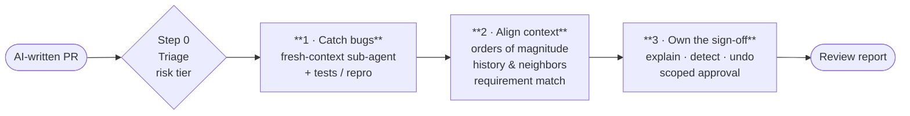

<div align="center">

# Looks Good to AI

<sub>Formerly AI Code Review Triage</sub>

**AI는 사람이 읽는 속도보다 빠르게 코드를 씁니다. 더 열심히 읽지 말고, 다르게 리뷰하세요.**

"코드 읽기"를 세 가지 별개의 작업으로 나누어 AI가 작성한 pull request를 리뷰하는 [Agent Skill](https://agentskills.io)입니다.<br>
Claude Code, Codex, GitHub Copilot, Cursor, Gemini CLI, Antigravity, OpenCode, Windsurf, Cline, Roo Code, Kiro, Amp, Junie, Zed에서 실행되며, Aider에서는 일반 context로 로드됩니다.

<a href="README.md" title="English" aria-label="English">🇬🇧</a> ·
<a href="README.zh-CN.md" title="简体中文" aria-label="简体中文">🇨🇳</a> ·
<a href="README.ja.md" title="日本語" aria-label="日本語">🇯🇵</a> ·
<strong title="한국어" aria-label="한국어">🇰🇷</strong> ·
<a href="README.es.md" title="Español" aria-label="Español">🇪🇸</a> ·
<a href="README.pt-BR.md" title="Português (Brasil)" aria-label="Português (Brasil)">🇧🇷</a> ·
<a href="README.fr.md" title="Français" aria-label="Français">🇫🇷</a>

이 문서는 번역본입니다. 기준 문서는 영어 README입니다.

[](https://agentskills.io/specification)
[](#claude-code-plugin)
[](LICENSE)
[](CHANGELOG.md)
[](https://github.com/laulauraluo/looks-good-to-ai/actions/workflows/ci.yml)

<a href="#quick-start">빠른 시작</a> ·
<a href="#the-idea">핵심 아이디어</a> ·
<a href="#install">설치</a> ·
<a href="#usage">사용법</a> ·
<a href="#examples">예시</a> ·
<a href="#how-it-works">동작 방식</a> ·
<a href="#limits">한계</a>


</div>

---

## 문제

에이전트가 작성한 PR은 누구도 한 줄씩 리뷰할 수 없을 만큼 빠르게 쌓입니다. 더 꼼꼼히 읽는다고 크게 나아지지도 않습니다. 코드 겉모습이 깔끔해서, 진짜 문제는 주의 깊게 읽어도 살아남을 만큼 잘 숨어 있습니다. "일단 merge하고 깨지면 롤백하자"는 기술적으로는 가능하지만, 장애에 대한 책임은 여전히 사람이 집니다.

<a id="quick-start"></a>
## 빠른 시작

```sh
npx skills add laulauraluo/looks-good-to-ai
```

[`skills`](https://github.com/vercel-labs/skills) CLI가 어떤 에이전트를 설정할지 묻습니다. 이 프로젝트 대신 사용자 단위로 설치하려면 `-g`를, 질문을 건너뛰려면 `-a <agent>`를 추가하세요 (`-a claude-code`, `-a codex`, `-a github-copilot`, `-a cursor`, …).

또는 각 에이전트 자체의 설치 도구를 사용하세요:

| 에이전트 | 명령 |
|---|---|
| Claude Code | `/plugin marketplace add laulauraluo/looks-good-to-ai` 다음 `/plugin install looks-good-to-ai@looks-good-to-ai` |
| Codex | `codex plugin marketplace add laulauraluo/looks-good-to-ai` 다음 `codex plugin add looks-good-to-ai@looks-good-to-ai` |
| GitHub Copilot CLI | `copilot plugin marketplace add laulauraluo/looks-good-to-ai` 다음 `copilot plugin install looks-good-to-ai@looks-good-to-ai` |
| Gemini CLI | `gemini extensions install https://github.com/laulauraluo/looks-good-to-ai` |

그다음 에이전트에서:

```text
Review this AI-generated PR before I merge it.
```

이런 요청이면 skill이 자동으로 로드됩니다. 대부분의 에이전트는 `/looks-good-to-ai`로 이름을 불러 호출할 수도 있고, Codex는 `$looks-good-to-ai`를 사용합니다. 에이전트별 명령은 [docs/agents.md](docs/agents.md)에 있습니다.

<a id="the-idea"></a>
## 핵심 아이디어

"코드 리뷰"는 늘 세 가지 다른 작업을 한데 묶어 왔습니다. 코드가 천천히 들어오던 시절에는 그걸로 충분했습니다. 에이전트의 속도에서는 작업마다 별도의 프로세스가 필요합니다:



| 작업 | 질문 | 가장 잘하는 주체 |
|---|---|---|
| **버그 잡기** | 코드가 틀렸는가? | 기계, *독립적인* 두 번째 검토와 함께 |
| **context 맞추기** | 지금 이 제품에 맞는 변경인가? | 사람, diff에 드러나지 않는 각도를 확인하며 |
| **sign-off 책임지기** | 여기에 내 이름을 걸 것인가? | 승인자, 명시적인 범위와 함께 |

저위험 PR은 Step 1만 실행합니다. 중위험 PR은 Step 1과 2를 실행합니다. 고위험 PR(프로덕션 동작, 데이터, 보안, 돈)은 세 단계를 모두 실행합니다.

### 한 줄씩 읽는 리뷰가 놓치는 것을 잡아냅니다

> 어떤 PR이 `SESSION_TIMEOUT = 30`을 `30000`으로 바꾸고 단위 변환 한 줄을 지웁니다. 테스트는 통과합니다. 코드는 깔끔합니다. 한 줄씩 읽는 리뷰어는 30초 만에 승인합니다.
>
> - **Step 1**에서는 fresh-context sub-agent가 경계값 테스트를 추가합니다. 결과: 세션이 이제 **30초** 후에 만료됩니다.
> - **Step 2**에서는 히스토리와 호출부를 확인합니다. 같은 변경이 이전에 한 번 revert된 적이 있고, 모바일 클라이언트는 이전 값을 하드코딩하고 있으며, 요청은 "로그인 상태 유지" 사용자만 대상이었는데 diff는 모든 사용자를 바꿉니다.
> - **Step 3**에서는 승인을 막습니다. 이 PR이 실제로 무엇을 하는지 아무도 설명할 수 없기 때문입니다.
>
> 전체 실행 과정: [examples/session-timeout-walkthrough.md](examples/session-timeout-walkthrough.md)

<a id="install"></a>
## 설치

skill은 [`skills/looks-good-to-ai/`](skills/looks-good-to-ai) 폴더입니다. 아래 모든 에이전트가 이를 수정 없이 로드하며, 폴더 위치만 다릅니다. 각 에이전트가 읽는 모든 폴더, skill 호출 방식, 각 에이전트 공식 문서 링크가 담긴 전체 표는 [docs/agents.md](docs/agents.md)에 있습니다.

| 에이전트 | skills CLI | 또는 폴더를 복사할 위치 (사용자 · 프로젝트) |
|---|---|---|
| Claude Code | `-a claude-code` | `~/.claude/skills/` · `.claude/skills/` |
| Codex | `-a codex` | `~/.agents/skills/` · `.agents/skills/` |
| GitHub Copilot | `-a github-copilot` | `~/.copilot/skills/` · `.github/skills/` |
| Cursor | `-a cursor` | `~/.cursor/skills/` · `.cursor/skills/` |
| Gemini CLI | `-a gemini-cli` | `~/.gemini/skills/` · `.gemini/skills/` |
| Antigravity | `-a antigravity` | `~/.gemini/config/skills/` · `.agents/skills/` |
| OpenCode | `-a opencode` | `~/.config/opencode/skills/` · `.opencode/skills/` |
| Windsurf | `-a windsurf` | `~/.config/devin/skills/` · `.devin/skills/` |
| Cline | 직접 복사 ([이유](docs/agents.md#cline)) | `~/.cline/skills/` · `.cline/skills/` |
| Roo Code | `-a roo` | `~/.roo/skills/` · `.roo/skills/` |
| Kiro | `-a kiro-cli` | `~/.kiro/skills/` · `.kiro/skills/` |
| Amp | `-a amp` | `~/.config/agents/skills/` · `.agents/skills/` |
| Junie | `-a junie` | `~/.junie/skills/` · `.junie/skills/` |
| Zed | `-a zed` | `~/.agents/skills/` · `.agents/skills/` |
| Aider | — | `.aider.conf.yml`의 `read:` ([방법](docs/agents.md#aider)) |
| Continue | — | 검증되지 않음; rule로 로드 ([방법](docs/agents.md#continue)) |

<details>
<summary><b>CLI 없이 git으로</b></summary>

<br>

저장소를 한 번 clone한 뒤, skill 폴더를 표에 있는 에이전트 폴더로 복사해서 `SKILL.md`가 `<folder>/looks-good-to-ai/SKILL.md`에 위치하도록 하세요:

```sh
git clone https://github.com/laulauraluo/looks-good-to-ai.git
cp -r looks-good-to-ai/skills/looks-good-to-ai ~/.claude/skills/
```

`~/.claude/skills/`는 표의 다른 폴더로 바꿔도 됩니다. 프로젝트 단위로 설치할 때는 복사한 폴더를 commit하면 팀원도 함께 받을 수 있습니다.

</details>

<details id="claude-code-plugin">
<summary><b>Claude Code plugin</b></summary>

<br>

Claude Code 안에서:

```text
/plugin marketplace add laulauraluo/looks-good-to-ai
/plugin install looks-good-to-ai@looks-good-to-ai
```

</details>

<a id="usage"></a>
## 사용법

에이전트에게 이렇게 물어보세요:

- *"이 AI가 생성한 PR을 merge하기 전에 리뷰해 줘."*
- *"이 diff merge해도 될까? Codex가 작성했어."*
- *"#123을 승인하려고 해. 먼저 뭘 확인해야 할까?"*
- *"에이전트 PR이 너무 많아서 한 줄씩 읽을 수가 없어. 이거 triage해 줘."*

다음과 같은 리포트를 받게 됩니다 (가상의 timeout 예시에서 발췌):

```markdown
## Extend session lifetime for "remember me" · Risk: High

### 1. Bugs (independent fresh-context review)
- [CONFIRMED] auth/session.py:3 — unit conversion dropped; sessions expire after 30 s. Repro: test_session_expires_after_timeout

### 2. Context
- Magnitudes: SESSION_TIMEOUT 30 → 30000 (comment says min, code treats as ms) — suspicious
- History / neighbors: reverted once before (a1b2c3d); mobile/src/config.ts hard-codes 30 min
- Requirement match: asked for remember-me users only; diff changes everyone

### 3. Sign-off
- Detection: login-rate and 401-rate alerts · Rollback: config revert
- Recommendation: request changes
- Verification scope: verified units and callers; did not load-test

<sub>Reviewed with [Looks Good to AI](https://github.com/laulauraluo/looks-good-to-ai)</sub>
```

<details>
<summary><b>더 많은 프롬프트</b>, skill의 <a href="evals/evals.json">evals</a>에서</summary>

<br>

```text
Here's the diff for PR #482. Cursor wrote it to raise our retry count from 3 to 10 on the payments client. Tests pass. Can I approve it?
```

```text
Copilot opened a PR that only fixes typos in docs/ and the README. Do I need the full review process?
```

```text
I wrote this change with you in this session. Now review it before I merge.
```

</details>

<a id="examples"></a>
## 예시

두 walkthrough 모두 하나의 PR이 모든 단계를 거치는 과정을 따라가는 가상의 시나리오입니다.

| Walkthrough | 무엇이 잘못되는가 | 무엇이 찾아내는가 |
|---|---|---|
| [Session timeout](examples/session-timeout-walkthrough.md) | 단위 변환이 빠진 채 `30` → `30000`: 모든 사용자의 세션이 30초 후에 만료됩니다. | Step 1의 경계값 테스트; Step 2의 단위, 과거 revert, 모바일에 하드코딩된 값. |
| [Pagination limit](examples/pagination-limit-walkthrough.md) | 페이지당 최대 100개로 제한하는 provider를 상대로 페이지 크기를 `100` → `1000`으로 변경: export가 250행 중 150행이 빠진 채 끝납니다. | Step 2의 provider 계약, 그리고 직접 실행해 볼 수 있는 표준 라이브러리 Python 재현 코드. |

<a id="how-it-works"></a>
## 동작 방식

- **[`SKILL.md`](skills/looks-good-to-ai/SKILL.md)** 는 에이전트가 읽는 파일입니다: 위험 등급, 세 단계, 히스토리와 호출부를 찾는 명령, 리포트 템플릿.
- **Step 1에는 깨끗한 두 번째 context가 필요합니다.** 코드를 작성한 세션은 그 코드를 독립적으로 리뷰할 수 없습니다. [`references/subagents.md`](skills/looks-good-to-ai/references/subagents.md)는 에이전트별로 새 리뷰어를 띄우는 방법과, 그런 기능이 없는 에이전트에서 할 일을 보여줍니다.
- **Step 2에는 `git`이 있는 shell이 필요합니다.** `git log -S`, `git log --grep=revert`, `grep`을 실행해 diff에 드러나지 않는 히스토리와 호출부를 찾습니다.
- **[`evals/evals.json`](evals/evals.json)** 에는 테스트 프롬프트와 좋은 답변에 담겨야 할 내용이 있습니다. CI는 skill의 frontmatter가 [Agent Skills spec](https://agentskills.io/specification)을 따르는지, 그리고 pagination 재현 코드가 여전히 실행되는지 확인합니다.

<details>
<summary><b>저장소 구조</b></summary>

<br>

```text
looks-good-to-ai/
├── skills/looks-good-to-ai/   the skill (this folder is what gets installed)
│   ├── SKILL.md                    workflow, risk tiers, report template
│   ├── references/subagents.md     a fresh-context reviewer in each agent
│   └── agents/openai.yaml          display name for the Codex and ChatGPT apps
├── docs/
│   ├── agents.md                   install and use in each agent, with sources
│   └── review-ai-generated-code.md questions and answers
├── examples/                       two invented end-to-end walkthroughs
├── evals/evals.json                test prompts and expected answers
├── scripts/check.py                the checks CI runs
├── .claude-plugin/                 plugin and marketplace manifests (Claude Code, Codex, Copilot CLI)
├── gemini-extension.json           Gemini CLI extension manifest
└── .github/                        CI, issue forms, PR template
```

</details>

<a id="limits"></a>
## 한계

- **이것은 리뷰 프로세스이지 스캐너가 아닙니다.** 승인 전에 무엇이 참이어야 하는지를 결정합니다. linter, 타입 체커, 보안 도구는 Step 1 안에서 실행하세요. 이 skill이 그것들을 대체하지는 않습니다.
- **PR이 안전하다고 보장할 수는 없습니다.** 예시는 교육용으로 만든 가상 사례이지, 측정된 탐지율이 아닙니다.
- **대충 훑어보는 것보다 의도적으로 느립니다.** 고위험 PR은 sub-agent 검토, 테스트, 히스토리 검색, 서면 sign-off를 거칩니다. 저위험 PR은 대부분을 건너뜁니다.
- **Step 1의 독립성은 주어진 리뷰어의 독립성만큼입니다.** sub-agent가 없는 에이전트에서는 직접 새 세션을 여세요.

"Codex 출력도 리뷰할 수 있나요?", "테스트가 통과해도 export가 불완전한 걸 놓치는 이유는?" 같은 질문은 [docs/review-ai-generated-code.md](docs/review-ai-generated-code.md)에 답이 있습니다.

## 함께 쓰면 좋은 것

이 skill은 리뷰를 정리하고 승인 전에 무엇이 참이어야 하는지를 결정합니다. 전문 검사 도구를 대체하지는 않습니다. 그것들은 Step 1 안에서 실행하세요:

- 정확성 중심의 리뷰 (예: Claude Code의 내장 `/code-review`, 또는 Copilot CLI의 code-review 에이전트)
- 보안 및 성능 체크리스트
- 과잉 설계(over-engineering) 리뷰

## 기여하기

Issue와 pull request를 환영합니다. 먼저 [CONTRIBUTING.md](CONTRIBUTING.md)를 읽어 주세요: 작업 사본을 에이전트에 연결하는 방법, CI가 실행하는 검사, `SKILL.md` 변경 시 지켜야 할 사항을 다룹니다.

- [문제 보고](https://github.com/laulauraluo/looks-good-to-ai/issues/new?template=bug_report.yml)
- [에이전트 추가 또는 수정](https://github.com/laulauraluo/looks-good-to-ai/issues/new?template=agent_support.yml)
- [Changelog](CHANGELOG.md)

## 감사의 말

세 가지 작업으로 나누는 관점은 AI가 작성한 코드 리뷰에 관한 [공개 강연](https://www.bilibili.com/video/BV1mRn66JERc/)에서 영감을 받았습니다. 멀티 에이전트 설치 구조는 [Anatomy](https://github.com/wheresryan22/anatomy)를 따랐습니다.

## License

[MIT](LICENSE)

---

<div align="center">

이 도구가 잘못된 merge를 막아 주었다면, ⭐ 하나가 다른 리뷰어들이 이 도구를 찾는 데 도움이 됩니다.

</div>
