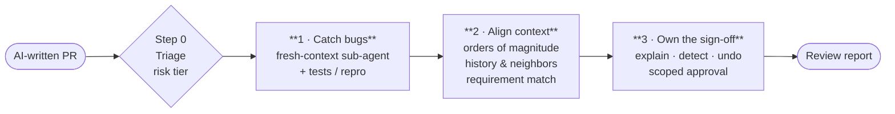

<div align="center">

# AI Code Review Triage

**AI writes code faster than you can read it. Stop reading harder and review differently.**

A [Claude Code](https://claude.com/claude-code) skill that reviews AI-generated pull requests by splitting "reading the code" into three separate jobs.

[](LICENSE)


</div>

---

## The problem

Agent-written PRs pile up faster than anyone can review them line by line. Reading harder doesn't help much either: the code is tidy on the surface, so the real problems hide well enough to survive a careful read. "Just merge and roll back if it breaks" works technically, but a human still answers for the incident.

## The idea

"Reviewing code" has always bundled three different jobs. That worked when code arrived slowly. At agent speed, each job needs its own process:



| Job | Question | Who does it best |
|---|---|---|
| **Catch bugs** | Is the code wrong? | Machines, with an *independent* second pass |
| **Align context** | Is this the right change for this product, today? | A human, checking angles the diff can't show |
| **Own the sign-off** | Will I put my name on this? | The approver, with an explicit scope |

Low-risk PRs only run Step 1. High-risk PRs (production behavior, data, security, money) run all three.

## What it catches that line-by-line review misses

> A PR changes `SESSION_TIMEOUT = 30` to `SESSION_TIMEOUT = 30000`. Tests pass. The code is clean.
>
> - **Step 1** (bug hunt) finds nothing. The code does what it says.
> - **Step 2** writes `SESSION_TIMEOUT: 30 → 30000 (s)` and asks whether 8+ hours is plausible. It finds that the caller expects milliseconds, and that a mobile client hard-codes the old value.
> - **Step 3** won't approve until there is a rollback path, and requires the approval comment to say what was verified.

## Install

**As a plugin** (inside Claude Code):

```
/plugin marketplace add laulauraluo/ai-code-review-triage
/plugin install ai-code-review-triage@ai-code-review-triage
```

**As a standalone skill:**

```bash
git clone https://github.com/laulauraluo/ai-code-review-triage.git
cp -r ai-code-review-triage/skills/ai-code-review-triage ~/.claude/skills/
```

## Usage

Ask Claude Code something like:

- *"Review this AI-generated PR before I merge it."*
- *"Can this diff be merged? Claude wrote it."*
- *"I'm about to approve #123. What should I verify first?"*

The skill triggers on its own and returns a report (illustrative example):

```markdown
## Extend session lifetime for "remember me" · Risk: High

### 1. Bugs (independent fresh-context review)
- No defects found. Tests, lint and type check pass.

### 2. Context
- Magnitudes: SESSION_TIMEOUT 30 → 30000 (s) — suspicious, ~8.3 h; auth/session.py:42 compares it as ms
- History / neighbors: mobile/config.ts hard-codes 30; a similar change was reverted 3 weeks ago

### 3. Sign-off
- Detection: auth error-rate alert · Rollback: feature flag `long_sessions`
- Recommendation: request changes
- Verification scope: verified units and callers; did not load-test
```

## Repository layout

```
.claude-plugin/
  plugin.json          # plugin manifest
  marketplace.json     # lets /plugin marketplace add this repo
skills/
  ai-code-review-triage/
    SKILL.md           # the skill itself
```

## Works well with

This skill organizes the review and decides what has to be true before you approve. It doesn't replace specialized checkers. Run them inside Step 1:

- correctness-focused review (e.g. Claude Code's built-in `/code-review`)
- security / performance checklists
- over-engineering reviews

## Acknowledgments

The three-job framing was inspired by a talk by [grapeot](https://www.bilibili.com/video/BV1mRn66JERc/) on reviewing AI-written code.

## License

[MIT](LICENSE)
