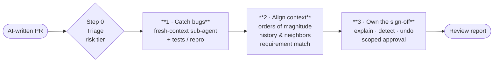

<div align="center">

# Looks Good to AI

<sub>Formerly AI Code Review Triage</sub>

**AI writes code faster than you can read it. Stop reading harder and review differently.**

A code review [Agent Skill](https://agentskills.io) for AI-written pull requests. It splits "reading the code" into three separate jobs.<br>
Runs in Claude Code, Codex, GitHub Copilot, Cursor, Gemini CLI, Antigravity, OpenCode, Windsurf, Cline, Roo Code, Kiro, Amp, Junie and Zed, and loads as plain context in Aider.

<strong title="English" aria-label="English">🇬🇧</strong> ·
<a href="README.zh-CN.md" title="简体中文" aria-label="简体中文">🇨🇳</a> ·
<a href="README.ja.md" title="日本語" aria-label="日本語">🇯🇵</a> ·
<a href="README.ko.md" title="한국어" aria-label="한국어">🇰🇷</a> ·
<a href="README.es.md" title="Español" aria-label="Español">🇪🇸</a> ·
<a href="README.pt-BR.md" title="Português (Brasil)" aria-label="Português (Brasil)">🇧🇷</a> ·
<a href="README.fr.md" title="Français" aria-label="Français">🇫🇷</a>

[](https://agentskills.io/specification)
[](#claude-code-plugin)
[](LICENSE)
[](CHANGELOG.md)
[](https://github.com/laulauraluo/looks-good-to-ai/actions/workflows/ci.yml)

<a href="#quick-start">Quick start</a> ·
<a href="#the-idea">The idea</a> ·
<a href="#install">Install</a> ·
<a href="#usage">Usage</a> ·
<a href="#examples">Examples</a> ·
<a href="#how-it-works">How it works</a> ·
<a href="#limits">Limits</a>


</div>

---

## The problem

Agent-written PRs pile up faster than anyone can review them line by line. Reading harder doesn't help much either: the code is tidy on the surface, so the real problems hide well enough to survive a careful read. "Just merge and roll back if it breaks" works technically, but a human still answers for the incident.

## Quick start

```sh
npx skills add laulauraluo/looks-good-to-ai
```

The [`skills`](https://github.com/vercel-labs/skills) CLI asks which agents to set up. Add `-g` to install for your user instead of this project, and `-a <agent>` to skip the question (`-a claude-code`, `-a codex`, `-a github-copilot`, `-a cursor`, …).

Or use the agent's own installer:

| Agent | Command |
|---|---|
| Claude Code | `/plugin marketplace add laulauraluo/looks-good-to-ai` then `/plugin install looks-good-to-ai@looks-good-to-ai` |
| Codex | `codex plugin marketplace add laulauraluo/looks-good-to-ai` then `codex plugin add looks-good-to-ai@looks-good-to-ai` |
| GitHub Copilot CLI | `copilot plugin marketplace add laulauraluo/looks-good-to-ai` then `copilot plugin install looks-good-to-ai@looks-good-to-ai` |
| Gemini CLI | `gemini extensions install https://github.com/laulauraluo/looks-good-to-ai` |

Then, in your agent:

```text
Review this AI-generated PR before I merge it.
```

The skill loads on its own from a request like that. Most agents also take `/looks-good-to-ai` to call it by name; Codex uses `$looks-good-to-ai`. [docs/agents.md](docs/agents.md) has the command for each agent.

## The idea

"Reviewing code" has always bundled three different jobs. That worked when code arrived slowly. At agent speed, each job needs its own process:



| Job | Question | Who does it best |
|---|---|---|
| **Catch bugs** | Is the code wrong? | Machines, with an *independent* second pass |
| **Align context** | Is this the right change for this product, today? | A human, checking angles the diff can't show |
| **Own the sign-off** | Will I put my name on this? | The approver, with an explicit scope |

Low-risk PRs only run Step 1. Medium-risk PRs run Steps 1 and 2. High-risk PRs (production behavior, data, security, money) run all three.

### What it catches that line-by-line review misses

> A PR changes `SESSION_TIMEOUT = 30` to `30000` and drops one line of unit conversion. Tests pass. The code is clean. A line-by-line reader approves it in 30 seconds.
>
> - **Step 1** has a fresh-context sub-agent add a boundary test. Result: sessions now expire after **30 seconds**.
> - **Step 2** checks history and callers. The same change was reverted once before, the mobile client hard-codes the old value, and the request was only for "remember me" users while the diff changes everyone.
> - **Step 3** blocks the approval. Nobody can explain what the PR actually does.
>
> Full run: [examples/session-timeout-walkthrough.md](examples/session-timeout-walkthrough.md)

## Install

The skill is the folder [`skills/looks-good-to-ai/`](skills/looks-good-to-ai). Every agent below loads it unchanged; only the folder differs. [docs/agents.md](docs/agents.md) has the full table with every folder each agent reads, the way each agent calls a skill, and a link to each agent's own documentation.

| Agent | skills CLI | Or copy the folder to (user · project) |
|---|---|---|
| Claude Code | `-a claude-code` | `~/.claude/skills/` · `.claude/skills/` |
| Codex | `-a codex` | `~/.agents/skills/` · `.agents/skills/` |
| GitHub Copilot | `-a github-copilot` | `~/.copilot/skills/` · `.github/skills/` |
| Cursor | `-a cursor` | `~/.cursor/skills/` · `.cursor/skills/` |
| Gemini CLI | `-a gemini-cli` | `~/.gemini/skills/` · `.gemini/skills/` |
| Antigravity | `-a antigravity` | `~/.gemini/config/skills/` · `.agents/skills/` |
| OpenCode | `-a opencode` | `~/.config/opencode/skills/` · `.opencode/skills/` |
| Windsurf | `-a windsurf` | `~/.config/devin/skills/` · `.devin/skills/` |
| Cline | copy by hand ([why](docs/agents.md#cline)) | `~/.cline/skills/` · `.cline/skills/` |
| Roo Code | `-a roo` | `~/.roo/skills/` · `.roo/skills/` |
| Kiro | `-a kiro-cli` | `~/.kiro/skills/` · `.kiro/skills/` |
| Amp | `-a amp` | `~/.config/agents/skills/` · `.agents/skills/` |
| Junie | `-a junie` | `~/.junie/skills/` · `.junie/skills/` |
| Zed | `-a zed` | `~/.agents/skills/` · `.agents/skills/` |
| Aider | — | `read:` in `.aider.conf.yml` ([how](docs/agents.md#aider)) |
| Continue | — | Unverified; load as a rule ([how](docs/agents.md#continue)) |

<details>
<summary><b>With git, no CLI</b></summary>

<br>

Clone the repository once and copy the skill folder into the agent's folder from the table, so that `SKILL.md` ends up at `<folder>/looks-good-to-ai/SKILL.md`:

```sh
git clone https://github.com/laulauraluo/looks-good-to-ai.git
cp -r looks-good-to-ai/skills/looks-good-to-ai ~/.claude/skills/
```

Swap `~/.claude/skills/` for any other folder in the table. For a project install, commit the copied folder so your team gets it too.

</details>

<details>
<summary><b>On every pull request (GitHub Actions)</b></summary>

<br>

A reusable workflow runs the skill on each pull request and posts the report as a comment. Setup takes three steps: [docs/github-action.md](docs/github-action.md).

</details>

<details id="claude-code-plugin">
<summary><b>Claude Code plugin</b></summary>

<br>

Inside Claude Code:

```text
/plugin marketplace add laulauraluo/looks-good-to-ai
/plugin install looks-good-to-ai@looks-good-to-ai
```

</details>

## Usage

Ask your agent something like:

- *"Review this AI-generated PR before I merge it."*
- *"Can this diff be merged? Codex wrote it."*
- *"I'm about to approve #123. What should I verify first?"*
- *"We have too many agent PRs to read line by line. Triage this one."*

You get a report like this (from the invented timeout example):

```markdown
## Extend session lifetime for "remember me" · Risk: High

### 1. Bugs (independent fresh-context review)
- [CONFIRMED] auth/session.py:3 — unit conversion dropped; sessions expire after 30 s. Repro: test_session_expires_after_timeout

### 2. Context
- Magnitudes: SESSION_TIMEOUT 30 → 30000 (comment says min, code treats as ms) — suspicious
- History / neighbors: reverted once before (a1b2c3d); mobile/src/config.ts hard-codes 30 min
- Requirement match: asked for remember-me users only; diff changes everyone

### 3. Sign-off
- Detection: login-rate and 401-rate alerts · Rollback: config revert
- Recommendation: request changes
- Verification scope: verified units and callers; did not load-test

<sub>Reviewed with [Looks Good to AI](https://github.com/laulauraluo/looks-good-to-ai)</sub>
```

The last line credits the skill when you paste the report into a PR. Ask the agent to leave it out if you don't want it.

<details>
<summary><b>More prompts</b>, from the skill's <a href="evals/evals.json">evals</a></summary>

<br>

```text
Here's the diff for PR #482. Cursor wrote it to raise our retry count from 3 to 10 on the payments client. Tests pass. Can I approve it?
```

```text
Copilot opened a PR that only fixes typos in docs/ and the README. Do I need the full review process?
```

```text
I wrote this change with you in this session. Now review it before I merge.
```

</details>

## Examples

One real PR, reviewed after the fact, and two invented walkthroughs that follow one PR through every step.

| Walkthrough | What goes wrong | What finds it |
|---|---|---|
| [Real PR: LightBulb #413](examples/lightbulb-real-pr.md) | A Copilot PR to cut idle CPU/RAM, merged after dozens of review rounds with full coverage, reverted eight months later. | A blind Step 1 pass flagged the Settings bug users later reported; Step 2 found that nobody had measured CPU or RAM, the reason for the revert. |
| [Session timeout](examples/session-timeout-walkthrough.md) | `30` → `30000` with the unit conversion dropped: sessions expire after 30 seconds, for every user. | A boundary test in Step 1; units, a past revert and a hard-coded mobile value in Step 2. |
| [Pagination limit](examples/pagination-limit-walkthrough.md) | Page size `100` → `1000` against a provider that caps pages at 100: the export stops with 150 of 250 rows missing. | The provider contract in Step 2, and a standard-library Python reproduction you can run. |

## How it works

- **[`SKILL.md`](skills/looks-good-to-ai/SKILL.md)** is what the agent reads: the risk tiers, the three steps, the commands for history and callers, and the report template.
- **Step 1 needs a second, clean context.** The session that wrote the code can't review it independently. [`references/subagents.md`](skills/looks-good-to-ai/references/subagents.md) shows how each agent starts a fresh reviewer, and what to do in agents that have none.
- **Step 2 needs a shell with `git`.** It runs `git log -S`, `git log --grep=revert` and `grep` to find history and callers the diff doesn't show.
- **[`evals/evals.json`](evals/evals.json)** holds test prompts and what a good answer contains. CI checks that the skill's frontmatter follows the [Agent Skills spec](https://agentskills.io/specification) and that the pagination reproduction still runs.

<details>
<summary><b>Repository layout</b></summary>

<br>

```text
looks-good-to-ai/
├── skills/looks-good-to-ai/   the skill (this folder is what gets installed)
│   ├── SKILL.md                    workflow, risk tiers, report template
│   ├── references/subagents.md     a fresh-context reviewer in each agent
│   └── agents/openai.yaml          display name for the Codex and ChatGPT apps
├── docs/
│   ├── agents.md                   install and use in each agent, with sources
│   └── review-ai-generated-code.md questions and answers
├── examples/                       one real PR and two invented walkthroughs
├── evals/evals.json                test prompts and expected answers
├── scripts/check.py                the checks CI runs
├── .claude-plugin/                 plugin and marketplace manifests (Claude Code, Codex, Copilot CLI)
├── gemini-extension.json           Gemini CLI extension manifest
└── .github/                        CI, issue forms, PR template
```

</details>

## Limits

- **It is a review process, not a scanner.** It decides what has to be true before you approve. Run linters, type checkers and security tools inside Step 1; this skill does not replace them.
- **It can't guarantee a PR is safe.** The real PR was picked because it was already reverted, and the other two examples are invented. None of them is a measured detection rate.
- **It is slower than a skim, on purpose.** A high-risk PR gets a sub-agent pass, tests, history searches and a written sign-off. Low-risk PRs skip most of it.
- **Step 1 is only as independent as the reviewer you give it.** In agents without sub-agents, open a new session by hand.

Questions such as "can it review Codex output?" and "why can passing tests miss incomplete exports?" are answered in [docs/review-ai-generated-code.md](docs/review-ai-generated-code.md).

## Works well with

This skill organizes the review and decides what has to be true before you approve. It doesn't replace specialized checkers. Run them inside Step 1:

- a correctness-focused review (for example Claude Code's built-in `/code-review`, or Copilot CLI's code-review agent)
- security and performance checklists
- over-engineering reviews

## Contributing

Issues and pull requests are welcome. Read [CONTRIBUTING.md](CONTRIBUTING.md) first: it covers linking a working copy into your agent, the checks CI runs, and what a change to `SKILL.md` has to keep.

- [Report a problem](https://github.com/laulauraluo/looks-good-to-ai/issues/new?template=bug_report.yml)
- [Add or fix an agent](https://github.com/laulauraluo/looks-good-to-ai/issues/new?template=agent_support.yml)
- [Changelog](CHANGELOG.md)

## Acknowledgments

The three-job framing was inspired by [a public talk](https://www.bilibili.com/video/BV1mRn66JERc/) on reviewing AI-written code. The multi-agent install layout follows [Anatomy](https://github.com/wheresryan22/anatomy).

## License

[MIT](LICENSE)

---

<div align="center">

If this caught a bad merge for you, a ⭐ helps other reviewers find it.

</div>
