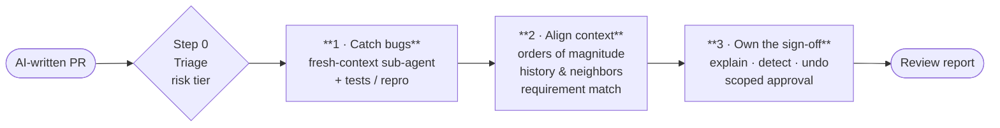

<div align="center">

# Looks Good to AI

<sub>Formerly AI Code Review Triage</sub>

**A IA escreve código mais rápido do que você consegue ler. Pare de ler com mais esforço e revise de outro jeito.**

Uma [Agent Skill](https://agentskills.io) que revisa pull requests escritos por IA dividindo "ler o código" em três tarefas separadas.<br>
Roda no Claude Code, Codex, GitHub Copilot, Cursor, Gemini CLI, Antigravity, OpenCode, Windsurf, Cline, Roo Code, Kiro, Amp, Junie e Zed, e carrega como contexto simples no Aider.

<a href="README.md" title="English" aria-label="English">🇬🇧</a> ·
<a href="README.zh-CN.md" title="简体中文" aria-label="简体中文">🇨🇳</a> ·
<a href="README.ja.md" title="日本語" aria-label="日本語">🇯🇵</a> ·
<a href="README.ko.md" title="한국어" aria-label="한국어">🇰🇷</a> ·
<a href="README.es.md" title="Español" aria-label="Español">🇪🇸</a> ·
<strong title="Português (Brasil)" aria-label="Português (Brasil)">🇧🇷</strong> ·
<a href="README.fr.md" title="Français" aria-label="Français">🇫🇷</a>

Esta é uma tradução; o README em inglês é a fonte oficial.

[](https://agentskills.io/specification)
[](#claude-code-plugin)
[](LICENSE)
[](CHANGELOG.md)
[](https://github.com/laulauraluo/looks-good-to-ai/actions/workflows/ci.yml)

<a href="#quick-start">Início rápido</a> ·
<a href="#the-idea">A ideia</a> ·
<a href="#install">Instalação</a> ·
<a href="#usage">Uso</a> ·
<a href="#examples">Exemplos</a> ·
<a href="#how-it-works">Como funciona</a> ·
<a href="#limits">Limitações</a>


</div>

---

## O problema

PRs escritos por agents se acumulam mais rápido do que qualquer pessoa consegue revisá-los linha por linha. Ler com mais atenção também não ajuda muito: o código parece arrumado na superfície, então os problemas reais ficam bem escondidos e sobrevivem a uma leitura cuidadosa. "É só dar merge e fazer rollback se quebrar" funciona tecnicamente, mas ainda é um humano que responde pelo incidente.

<a id="quick-start"></a>
## Início rápido

```sh
npx skills add laulauraluo/looks-good-to-ai
```

A CLI [`skills`](https://github.com/vercel-labs/skills) pergunta quais agents configurar. Adicione `-g` para instalar para o seu usuário em vez deste projeto, e `-a <agent>` para pular a pergunta (`-a claude-code`, `-a codex`, `-a github-copilot`, `-a cursor`, …).

Ou use o instalador do próprio agent:

| Agent | Comando |
|---|---|
| Claude Code | `/plugin marketplace add laulauraluo/looks-good-to-ai` depois `/plugin install looks-good-to-ai@looks-good-to-ai` |
| Codex | `codex plugin marketplace add laulauraluo/looks-good-to-ai` depois `codex plugin add looks-good-to-ai@looks-good-to-ai` |
| GitHub Copilot CLI | `copilot plugin marketplace add laulauraluo/looks-good-to-ai` depois `copilot plugin install looks-good-to-ai@looks-good-to-ai` |
| Gemini CLI | `gemini extensions install https://github.com/laulauraluo/looks-good-to-ai` |

Depois, no seu agent:

```text
Review this AI-generated PR before I merge it.
```

A skill carrega sozinha a partir de um pedido como esse. A maioria dos agents também aceita `/looks-good-to-ai` para chamá-la pelo nome; o Codex usa `$looks-good-to-ai`. O [docs/agents.md](docs/agents.md) tem o comando de cada agent.

<a id="the-idea"></a>
## A ideia

"Revisar código" sempre juntou três tarefas diferentes. Isso funcionava quando o código chegava devagar. Na velocidade dos agents, cada tarefa precisa do seu próprio processo:



| Tarefa | Pergunta | Quem faz melhor |
|---|---|---|
| **Pegar bugs** | O código está errado? | Máquinas, com uma segunda passada *independente* |
| **Alinhar contexto** | Esta é a mudança certa para este produto, hoje? | Um humano, verificando ângulos que o diff não mostra |
| **Assumir o sign-off** | Eu coloco meu nome nisso? | Quem aprova, com um escopo explícito |

PRs de baixo risco rodam só o Passo 1. PRs de risco médio rodam os Passos 1 e 2. PRs de alto risco (comportamento em produção, dados, segurança, dinheiro) rodam os três.

### O que ela pega e a revisão linha a linha deixa passar

> Um PR muda `SESSION_TIMEOUT = 30` para `30000` e remove uma linha de conversão de unidade. Os testes passam. O código está limpo. Quem lê linha por linha aprova em 30 segundos.
>
> - **Passo 1**: um sub-agent com contexto limpo adiciona um teste de limite. Resultado: as sessões agora expiram depois de **30 segundos**.
> - **Passo 2**: verifica o histórico e quem chama o código. A mesma mudança já sofreu revert uma vez, o cliente mobile tem o valor antigo fixo no código, e o pedido era só para usuários de "lembrar de mim", enquanto o diff muda para todo mundo.
> - **Passo 3**: bloqueia a aprovação. Ninguém consegue explicar o que o PR realmente faz.
>
> Execução completa: [examples/session-timeout-walkthrough.md](examples/session-timeout-walkthrough.md)

<a id="install"></a>
## Instalação

A skill é a pasta [`skills/looks-good-to-ai/`](skills/looks-good-to-ai). Todos os agents abaixo a carregam sem alterações; só a pasta muda. O [docs/agents.md](docs/agents.md) tem a tabela completa com todas as pastas que cada agent lê, como cada agent chama uma skill e um link para a documentação de cada agent.

| Agent | skills CLI | Ou copie a pasta para (usuário · projeto) |
|---|---|---|
| Claude Code | `-a claude-code` | `~/.claude/skills/` · `.claude/skills/` |
| Codex | `-a codex` | `~/.agents/skills/` · `.agents/skills/` |
| GitHub Copilot | `-a github-copilot` | `~/.copilot/skills/` · `.github/skills/` |
| Cursor | `-a cursor` | `~/.cursor/skills/` · `.cursor/skills/` |
| Gemini CLI | `-a gemini-cli` | `~/.gemini/skills/` · `.gemini/skills/` |
| Antigravity | `-a antigravity` | `~/.gemini/config/skills/` · `.agents/skills/` |
| OpenCode | `-a opencode` | `~/.config/opencode/skills/` · `.opencode/skills/` |
| Windsurf | `-a windsurf` | `~/.config/devin/skills/` · `.devin/skills/` |
| Cline | copie à mão ([por quê](docs/agents.md#cline)) | `~/.cline/skills/` · `.cline/skills/` |
| Roo Code | `-a roo` | `~/.roo/skills/` · `.roo/skills/` |
| Kiro | `-a kiro-cli` | `~/.kiro/skills/` · `.kiro/skills/` |
| Amp | `-a amp` | `~/.config/agents/skills/` · `.agents/skills/` |
| Junie | `-a junie` | `~/.junie/skills/` · `.junie/skills/` |
| Zed | `-a zed` | `~/.agents/skills/` · `.agents/skills/` |
| Aider | — | `read:` em `.aider.conf.yml` ([como](docs/agents.md#aider)) |
| Continue | — | Não verificado; carregue como rule ([como](docs/agents.md#continue)) |

<details>
<summary><b>Com git, sem CLI</b></summary>

<br>

Clone o repositório uma vez e copie a pasta da skill para a pasta do agent na tabela, de modo que o `SKILL.md` fique em `<folder>/looks-good-to-ai/SKILL.md`:

```sh
git clone https://github.com/laulauraluo/looks-good-to-ai.git
cp -r looks-good-to-ai/skills/looks-good-to-ai ~/.claude/skills/
```

Troque `~/.claude/skills/` por qualquer outra pasta da tabela. Para uma instalação no projeto, faça commit da pasta copiada para que seu time também a tenha.

</details>

<details id="claude-code-plugin">
<summary><b>Plugin do Claude Code</b></summary>

<br>

Dentro do Claude Code:

```text
/plugin marketplace add laulauraluo/looks-good-to-ai
/plugin install looks-good-to-ai@looks-good-to-ai
```

</details>

<a id="usage"></a>
## Uso

Peça ao seu agent algo como:

- *"Revise este PR gerado por IA antes de eu dar merge."*
- *"Este diff pode ser mergeado? Foi o Codex que escreveu."*
- *"Estou prestes a aprovar o #123. O que devo verificar primeiro?"*
- *"Temos PRs de agents demais para ler linha por linha. Faça a triagem deste."*

Você recebe um relatório como este (do exemplo inventado de timeout):

```markdown
## Extend session lifetime for "remember me" · Risk: High

### 1. Bugs (independent fresh-context review)
- [CONFIRMED] auth/session.py:3 — unit conversion dropped; sessions expire after 30 s. Repro: test_session_expires_after_timeout

### 2. Context
- Magnitudes: SESSION_TIMEOUT 30 → 30000 (comment says min, code treats as ms) — suspicious
- History / neighbors: reverted once before (a1b2c3d); mobile/src/config.ts hard-codes 30 min
- Requirement match: asked for remember-me users only; diff changes everyone

### 3. Sign-off
- Detection: login-rate and 401-rate alerts · Rollback: config revert
- Recommendation: request changes
- Verification scope: verified units and callers; did not load-test

<sub>Reviewed with [Looks Good to AI](https://github.com/laulauraluo/looks-good-to-ai)</sub>
```

<details>
<summary><b>Mais prompts</b>, dos <a href="evals/evals.json">evals</a> da skill</summary>

<br>

```text
Here's the diff for PR #482. Cursor wrote it to raise our retry count from 3 to 10 on the payments client. Tests pass. Can I approve it?
```

```text
Copilot opened a PR that only fixes typos in docs/ and the README. Do I need the full review process?
```

```text
I wrote this change with you in this session. Now review it before I merge.
```

</details>

<a id="examples"></a>
## Exemplos

Os dois walkthroughs são cenários inventados que acompanham um PR por todos os passos.

| Walkthrough | O que dá errado | O que encontra o problema |
|---|---|---|
| [Session timeout](examples/session-timeout-walkthrough.md) | `30` → `30000` com a conversão de unidade removida: as sessões expiram depois de 30 segundos, para todos os usuários. | Um teste de limite no Passo 1; unidades, um revert anterior e um valor fixo no código mobile no Passo 2. |
| [Pagination limit](examples/pagination-limit-walkthrough.md) | Tamanho de página `100` → `1000` contra um provedor que limita as páginas a 100: o export para com 150 de 250 linhas faltando. | O contrato do provedor no Passo 2, e uma reprodução em Python só com a biblioteca padrão que você pode rodar. |

<a id="how-it-works"></a>
## Como funciona

- **[`SKILL.md`](skills/looks-good-to-ai/SKILL.md)** é o que o agent lê: os níveis de risco, os três passos, os comandos para histórico e chamadores, e o template do relatório.
- **O Passo 1 precisa de um segundo contexto, limpo.** A sessão que escreveu o código não consegue revisá-lo de forma independente. O [`references/subagents.md`](skills/looks-good-to-ai/references/subagents.md) mostra como cada agent inicia um revisor novo, e o que fazer em agents que não têm isso.
- **O Passo 2 precisa de um shell com `git`.** Ele roda `git log -S`, `git log --grep=revert` e `grep` para encontrar histórico e chamadores que o diff não mostra.
- **[`evals/evals.json`](evals/evals.json)** guarda prompts de teste e o que uma boa resposta contém. O CI verifica se o frontmatter da skill segue a [Agent Skills spec](https://agentskills.io/specification) e se a reprodução de paginação ainda roda.

<details>
<summary><b>Estrutura do repositório</b></summary>

<br>

```text
looks-good-to-ai/
├── skills/looks-good-to-ai/   the skill (this folder is what gets installed)
│   ├── SKILL.md                    workflow, risk tiers, report template
│   ├── references/subagents.md     a fresh-context reviewer in each agent
│   └── agents/openai.yaml          display name for the Codex and ChatGPT apps
├── docs/
│   ├── agents.md                   install and use in each agent, with sources
│   └── review-ai-generated-code.md questions and answers
├── examples/                       two invented end-to-end walkthroughs
├── evals/evals.json                test prompts and expected answers
├── scripts/check.py                the checks CI runs
├── .claude-plugin/                 plugin and marketplace manifests (Claude Code, Codex, Copilot CLI)
├── gemini-extension.json           Gemini CLI extension manifest
└── .github/                        CI, issue forms, PR template
```

</details>

<a id="limits"></a>
## Limitações

- **É um processo de revisão, não um scanner.** Ele decide o que precisa ser verdade antes de você aprovar. Rode linters, type checkers e ferramentas de segurança dentro do Passo 1; esta skill não os substitui.
- **Não garante que um PR é seguro.** Os exemplos são casos didáticos inventados, não uma taxa de detecção medida.
- **É mais lento que uma passada de olho, de propósito.** Um PR de alto risco recebe uma passada de sub-agent, testes, buscas no histórico e um sign-off por escrito. PRs de baixo risco pulam a maior parte disso.
- **O Passo 1 só é tão independente quanto o revisor que você der a ele.** Em agents sem sub-agents, abra uma nova sessão manualmente.

Perguntas como "ela consegue revisar o output do Codex?" e "por que testes que passam podem deixar escapar exports incompletos?" são respondidas em [docs/review-ai-generated-code.md](docs/review-ai-generated-code.md).

## Funciona bem com

Esta skill organiza a revisão e decide o que precisa ser verdade antes de você aprovar. Ela não substitui verificadores especializados. Rode-os dentro do Passo 1:

- uma revisão focada em corretude (por exemplo o `/code-review` nativo do Claude Code, ou o code-review agent do Copilot CLI)
- checklists de segurança e performance
- revisões de over-engineering

## Contribuindo

Issues e pull requests são bem-vindos. Leia primeiro o [CONTRIBUTING.md](CONTRIBUTING.md): ele explica como linkar uma cópia de trabalho no seu agent, os checks que o CI roda e o que uma mudança no `SKILL.md` precisa preservar.

- [Reportar um problema](https://github.com/laulauraluo/looks-good-to-ai/issues/new?template=bug_report.yml)
- [Adicionar ou corrigir um agent](https://github.com/laulauraluo/looks-good-to-ai/issues/new?template=agent_support.yml)
- [Changelog](CHANGELOG.md)

## Agradecimentos

A divisão em três tarefas foi inspirada por [uma palestra pública](https://www.bilibili.com/video/BV1mRn66JERc/) sobre revisar código escrito por IA. A estrutura de instalação para múltiplos agents segue o [Anatomy](https://github.com/wheresryan22/anatomy).

## Licença

[MIT](LICENSE)

---

<div align="center">

Se isto evitou um merge ruim para você, uma ⭐ ajuda outros revisores a encontrá-lo.

</div>
