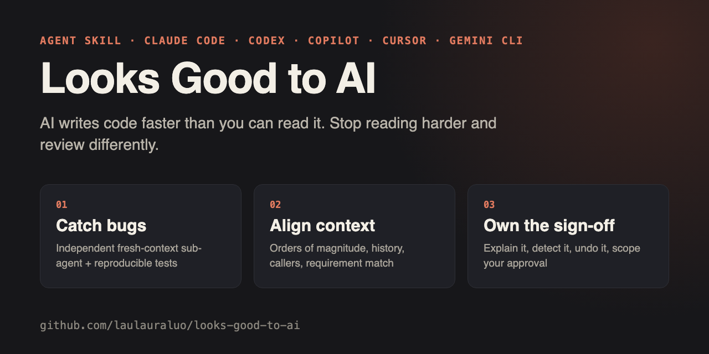

<div align="center">

# AI Code Review Triage

**AI 写代码比你读得快。别再硬读了，换个方式 review。**

一个 [Agent Skill](https://agentskills.io)：把「读代码」拆成三件事，专门用来 review AI 写的 PR。<br>
可以在 Claude Code、Codex、GitHub Copilot、Cursor、Gemini CLI、Antigravity、OpenCode、Windsurf、Cline、Roo Code、Kiro、Amp、Junie、Zed 里用，在 Aider 里可以作为只读 context 加载。

[English](README.md) · **简体中文**

[](https://agentskills.io/specification)
[](#claude-code-plugin)
[](LICENSE)
[](CHANGELOG.md)



</div>

---

## 问题

Agent 提 PR 的速度远超人逐行 review 的速度。更麻烦的是，读得再认真也不一定有用：AI 写的代码表面很整齐，真正的问题藏得深，逐行读完也看不出来。「不读，出事就回滚」技术上可行，但出了事背锅的还是人。

## 快速开始

```sh
npx skills add laulauraluo/ai-code-review-triage
```

[`skills`](https://github.com/vercel-labs/skills) CLI 会问你要装给哪些 agent。加 `-g` 装到用户目录（默认装到当前项目），加 `-a <agent>` 跳过提问，例如 `-a claude-code`、`-a codex`、`-a github-copilot`、`-a cursor`。

然后在 agent 里说：

```text
帮我 review 这个 AI 写的 PR，看能不能 merge。
```

skill 会按描述自动触发。多数 agent 也支持 `/ai-code-review-triage` 直接调用，Codex 用 `$ai-code-review-triage`。每个 agent 的调用方式见 [docs/agents.md](docs/agents.md)。

## 思路

「review 代码」一直混着三件不同的事。代码来得慢的时候，混着做没问题；到了 agent 的速度，每件事都需要自己的流程：

| 事情 | 回答什么问题 | 谁最擅长 |
|---|---|---|
| **挑错** | 代码写错了吗？ | 机器，并且要有*独立*的第二遍 |
| **对齐上下文** | 这个改动放在这个产品、这个时间点，对吗？ | 人，从 diff 看不到的角度核对 |
| **担责** | 我愿意在上面签字吗？ | approve 的人，并写明核对范围 |

低风险 PR 只跑第一步；中风险跑前两步；高风险 PR（线上行为、数据、安全、钱）三步全跑。

## 一个例子

> 一个 PR 把 `SESSION_TIMEOUT = 30` 改成 `30000`，测试全过，代码很干净。
>
> - **挑错**：独立的 sub-agent 补了一个边界测试，发现单位换算被删了，session 30 秒就过期。
> - **对齐上下文**：查历史，同样的改动之前被 revert 过；移动端还写死着旧值；而且需求只要求 remember-me 用户，diff 却改了所有人。
> - **担责**：说不清这个 PR 到底改了什么，就不签。
>
> 完整过程见 [examples/session-timeout-walkthrough.md](examples/session-timeout-walkthrough.md)。

第二个例子：[分页 limit walkthrough](examples/pagination-limit-walkthrough.md)。每页从 `100` 改成 `1000`，但上游最多返回 100 条，caller 误判已经结束，250 条数据只导出 100 条。包含可直接运行的 Python repro、API contract 核对和恢复范围。两个 walkthrough 都是虚构教学案例。

## 安装

skill 本体是 [`skills/ai-code-review-triage/`](skills/ai-code-review-triage) 这个文件夹，下面每个 agent 都原样加载它，只是放的位置不同。完整表格（每个 agent 读哪些目录、怎么调用、官方文档出处）见 [docs/agents.md](docs/agents.md)。

| Agent | skills CLI | 或手动拷到（用户 · 项目） |
|---|---|---|
| Claude Code | `-a claude-code` | `~/.claude/skills/` · `.claude/skills/` |
| Codex | `-a codex` | `~/.agents/skills/` · `.agents/skills/` |
| GitHub Copilot | `-a github-copilot` | `~/.copilot/skills/` · `.github/skills/` |
| Cursor | `-a cursor` | `~/.cursor/skills/` · `.cursor/skills/` |
| Gemini CLI | `-a gemini-cli` | `~/.gemini/skills/` · `.gemini/skills/` |
| Antigravity | `-a antigravity` | `~/.gemini/config/skills/` · `.agents/skills/` |
| OpenCode | `-a opencode` | `~/.config/opencode/skills/` · `.opencode/skills/` |
| Windsurf | `-a windsurf` | `~/.config/devin/skills/` · `.devin/skills/` |
| Cline | `-a cline` | `~/.cline/skills/` · `.cline/skills/` |
| Roo Code | `-a roo` | `~/.roo/skills/` · `.roo/skills/` |
| Kiro | `-a kiro-cli` | `~/.kiro/skills/` · `.kiro/skills/` |
| Amp | `-a amp` | `~/.config/agents/skills/` · `.agents/skills/` |
| Junie | `-a junie` | `~/.junie/skills/` · `.junie/skills/` |
| Zed | `-a zed` | `~/.agents/skills/` · `.agents/skills/` |
| Aider | — | 在 `.aider.conf.yml` 里用 `read:` 加载（[做法](docs/agents.md#aider)） |
| Continue | — | 未核实，作为 rule 加载（[做法](docs/agents.md#continue)） |

**用 git 手动装：**

```sh
git clone https://github.com/laulauraluo/ai-code-review-triage.git
cp -r ai-code-review-triage/skills/ai-code-review-triage ~/.claude/skills/
```

把 `~/.claude/skills/` 换成表里对应 agent 的目录即可。

<a id="claude-code-plugin"></a>**Claude Code plugin**（在 Claude Code 里）：

```text
/plugin marketplace add laulauraluo/ai-code-review-triage
/plugin install ai-code-review-triage@ai-code-review-triage
```

## 用法

直接对 agent 说：

- 「帮我 review 这个 AI 写的 PR，看能不能 merge」
- 「这个 diff 是 Codex 写的，能 merge 吗？」
- 「我要 approve #123 了，签字前该核对什么？」

skill 会输出一份三段式报告：挑错 / 上下文 / 签字，最后写明核对过什么、没核对什么。更多测试 prompt 见 [evals/evals.json](evals/evals.json)。

第一步要求一个没见过写代码过程的 reviewer。各 agent 怎么开 fresh-context sub-agent，没有 sub-agent 时怎么办，见 [references/subagents.md](skills/ai-code-review-triage/references/subagents.md)。

## 局限

- 这是 review 流程，不是 scanner。linter、type check、security 工具放在第一步里跑，skill 不替代它们，也不替代人的 merge 决策。
- 两个例子是虚构教学案例，不代表测出来的检出率。
- 刻意比扫一眼慢：高风险 PR 要跑 sub-agent、测试、查历史、写签字范围。

[Review 指南与 FAQ](docs/review-ai-generated-code.md) 回答了：AI 写的 PR 该查什么、为什么测试通过仍会漏数据、如何核对 caller 和上游 contract。

## 参与贡献

欢迎 issue 和 PR，先读 [CONTRIBUTING.md](CONTRIBUTING.md)。改动记录见 [CHANGELOG.md](CHANGELOG.md)。

## License

[MIT](LICENSE)

---

如果它帮你拦下过一次坏的 merge，点个 ⭐ 能让更多人看到它。
